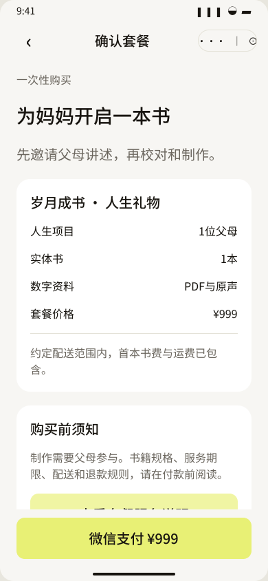
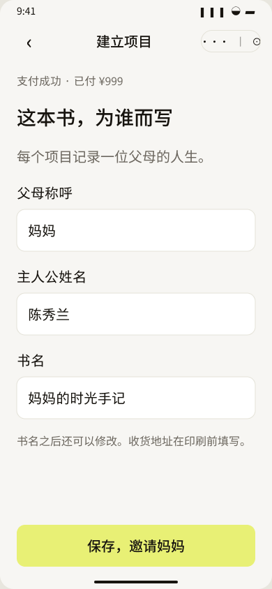
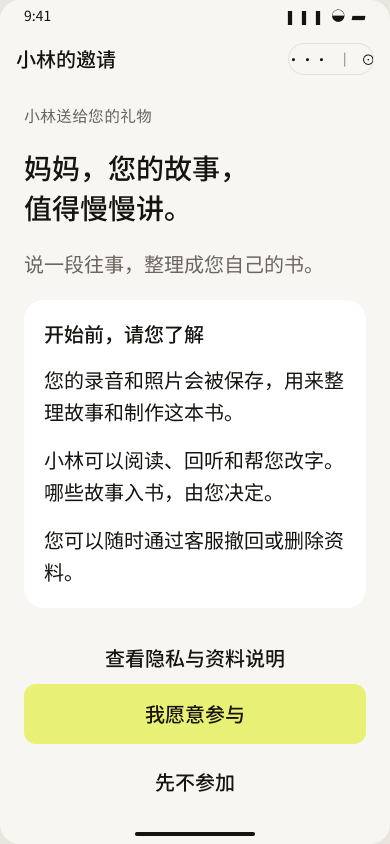
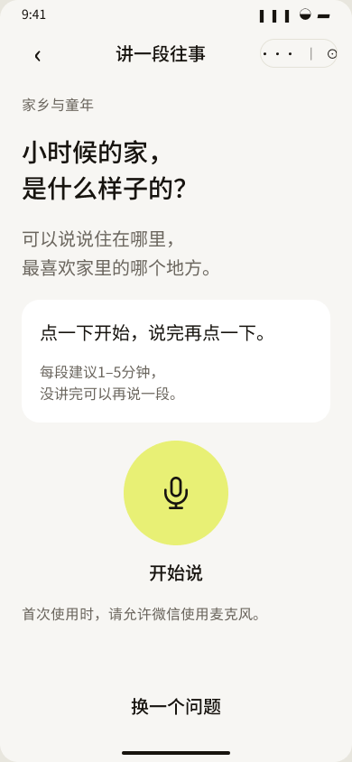
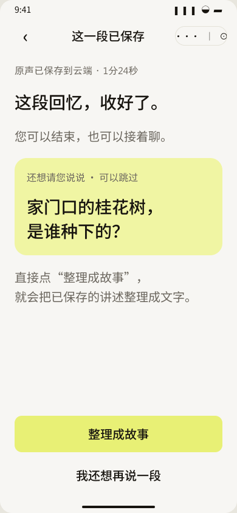
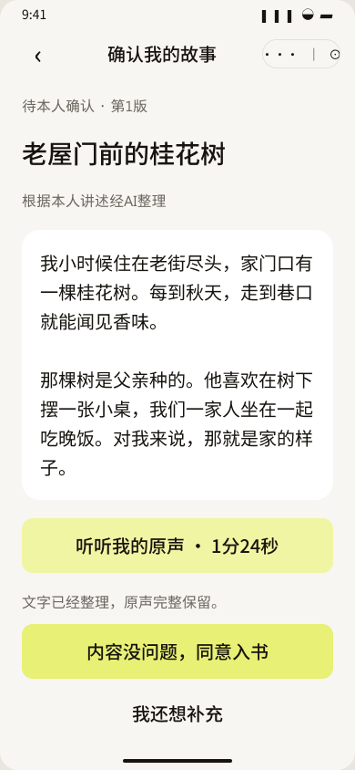
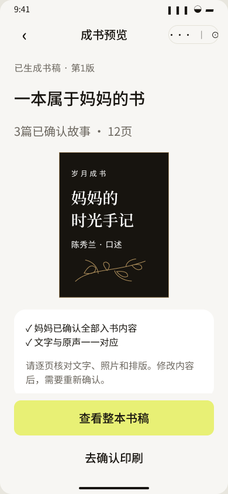
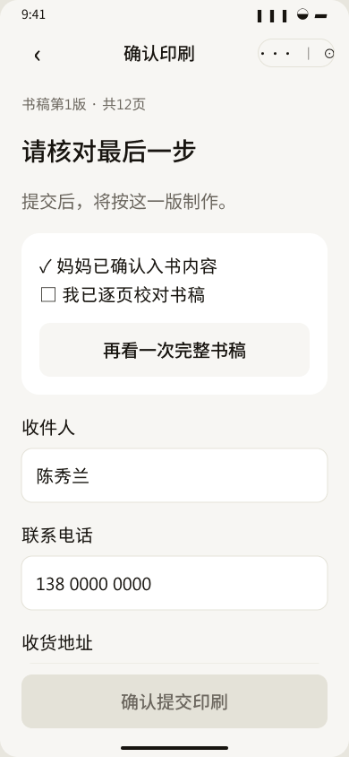

# 岁月成书：参考效果图与现有 Figma 的 MVP 对照评估

评估日期：2026-10-17。依据为用户提供的4张效果图、[PRD V0.3](../../docs/时光里_岁月成书_MVP_PRD.md)与本次从[Figma现有文件](https://www.figma.com/design/I4bopHPFyZW8oq7HoqoyhH)重新取得的9张画板截图。

建议：借鉴参考图的赠礼表达、人物与实体书展示、按对象进入的方式；沿用现有原型的分轮录音、明确保存状态、本人确认与确定版本印刷。优先完善购买和参与入口，不扩大聊天、模板、协作与交易能力。

这是基于画面、现有需求和流程的设计判断，尚未证明购买转化率或老人使用表现。参考图没有可操作原型，不能判断其录音是否实时、页面如何滚动或支付如何实现。本次没有修改 PRD 或 Figma。

## 参考图中可以借鉴的内容

| 来源 | 可借鉴的内容 | 对现有原型的具体帮助 | MVP做法 |
| --- | --- | --- | --- |
| 图1左：购买入口 | 父母与子女的关系、实体书、直接表达赠礼价值 | 当前P01只有小幅平面书封，成果与情感不够直观 | 一张有授权的亲情场景图或真实样书图；一句产品说明；醒目显示999元含一本书 |
| 图1左：按对象进入 | 送给妈妈、送给爸爸 | 当前P02在尚未选择对象前已写“为妈妈开启一本书” | 同一页面的两个简单选项，带入默认称呼和书名；不做两套业务流程 |
| 图1右：信息分组 | 选择有反馈、底部固定价格和行动按钮 | 比纯文本字段更容易理解下一步 | 保留选对象与套餐确认；主按钮直接写“微信支付999元” |
| 图2左：收到礼物 | 来自谁、为什么邀请我、我需要做什么 | 当前N01授权说明清楚，但情感动机偏弱 | 顶部增加赠礼人和一句固定亲情邀请；随后保留简明用途与共享范围 |
| 图2右：过程说明 | 将复杂制作过程概括为少量步骤 | 有助于消除父母“要写一本书”的负担 | “说一段 → 看看整理的故事 → 确认后成书”；并入邀请页，不增加强制引导页 |
| 图3右：故事成果 | 标题、文字、照片、原声入口放在一起 | 更容易感受到一段录音留下了什么 | 保留现有正文与原声；照片可选；确认动作优先于“继续下一个” |
| 图4左：书稿总览 | 实体书预览、目录、照片和原声说明 | 当前B02更像书封确认页，缺少内容概览 | 唯一模板的封面缩略图、简短目录、真实页数与完整书稿入口 |
| 图4右：印刷摘要 | 规格、地址、生产周期集中呈现 | 现有B04可以更直接说明最终交付 | 展示已付999元、首本权益已含、本次无需支付；周期按实际生产起算规则填写 |

这些改动主要改善信息与展示。默认称呼、书名及固定文案成本较低；自定义赠言若进入邀请和扉页，还涉及存储、排版及版本确认，不应被当成纯装饰。

## 不宜直接采用的内容

| 参考图内容 | 问题 | MVP处理 |
| --- | --- | --- |
| 付款前选四类对象、纪念场景、书名模板、写赠言 | 视觉有组织，但增加了付款前的决策；顶部四步与同页四区块也容易混淆进度 | 对象只保留妈妈、爸爸；书名默认，允许之后改；去掉必填场景、模板选择和赠言 |
| “爷爷奶奶”双人卡片、任意对象定制 | 一项目一主人公的边界变得模糊，可能引入双讲述者、双授权与内容归属 | 首批仍为子女给一位父亲或母亲购买；父母两人分别建项目 |
| 长聊天记录、AI头像、时间戳、语音与转录并列 | 画面中信息多，老人要理解当前问题与历史记录；消息恢复、失败、重试与故事归属也需要额外状态 | 一次一题、一段录音、一个可选追问；历史素材在故事内回听 |
| 按住说话 | 长时间持续按压，松手、滑动取消与中断恢复都需要明确处理 | 点一下开始，再点一下结束；保持醒目录音状态和保存结果 |
| 同时展示换题、找照片、继续讲、键盘、图片与麦克风 | 多个相近入口争夺注意力，照片入口重复 | 录音主页面只突出一个主要动作；换题和照片作为次要入口 |
| 固定“完成12/48个故事、25%” | 把人生记录变成固定题量任务，且不等同于可生产页数或书稿质量 | 显示已确认、待确认数量与真实制作阶段；篇数只做建议 |
| 每天20–30分钟、30–70题、约1个月成书 | 参与负担大，时间承诺依赖父母节奏、校对与生产 | 每段建议1–5分钟、可分次完成；明确内容积累与印刷交付两个阶段 |
| 多套封面、自由选模板、章节编辑与排序 | 每种组合都需验证排版、长文跨页、照片、二维码与生产一致性 | 一套封面及内页模板；保留书名与可选封面照片，后者已在PRD内 |
| 加印100元/本、印刷时再显示999元购买入口 | 新增计价、权益、支付、退款与生产数量分支，且可能让人以为首本还要再付费 | 删除加印；首本使用已购买权益，确认印刷不二次收费 |
| “约200页”、纸张、快递、付款后7–10工作日 | 这是供应链和成本承诺，不能由效果图决定；初次付款时还未形成书稿 | 打样和核算后确定；按书稿锁定并审核后的实际周期公示 |
| 分享给家人一起补充 | 引入多用户权限、内容作者、冲突和重新确认，超出两角色模型 | 仅购买子女和一位父母；保留已有的子女协助校对与补照片 |
| 生成后直接印刷、只提供“编辑/继续下一篇” | 画面未说明父母认可哪个版本，修改后如何重新确认 | 保留本人确认、是否入书、改稿重确认、完整PDF与印刷校对 |
| 暖色照片底上的小字、手写正文、深绿色按钮 | 装饰和低对比可能影响老人阅读；绿色与已确定方向不一致 | 奶油白与柠檬黄继续使用；正文无衬线大字，装饰限于营销及书封区域 |

图片中的人物、老照片与成书渲染是效果示意，不能直接充当真实客户案例或印刷品质证明。公开售卖应使用有权使用的素材和实际打样；父母人生故事中的照片应由家庭提供，不能以生成图补造真实经历。

## 聊天式交互的取舍

聊天气泡本身不代表实时语音，也不必然显著增加后端成本。图3展示的是语音消息、文字和追问，无法据此判断是否需要实时音频能力。

需要控制的是交互范围：任意轮次的持续消息流、语音与文字混合输入、逐条状态与重发、历史恢复、换题后归属、多个录音片段怎样形成一篇待确认故事。如果把这些能力一起纳入，就明显超过当前“一题—录音—保存—可选追问—整理”的状态范围。实时通话还会额外涉及双向音频、打断与时延，但这些不能从效果图中推定。

建议保留自然、亲切的问句，以及针对当前故事的一个可跳过追问。采访界面仍为问题卡与录音状态，避免做通用聊天界面。照片选择保留明确的前置入口；进入故事后可补照片。

## 建议的核心流程

1. **售前入口：需要增强。** 讲清“送给谁、父母要参与、999元包含什么、最终拿到什么”，同屏给出主要购买行动。参考图的大幅主视觉和底部价格不能按海报比例照搬；需在390×844真实视口内检查价格和按钮是否可见。
2. **购买与邀请：需要简化设置。** 选择妈妈或爸爸 → 确认999元套餐与边界 → 微信支付 → 自动建立项目 → 邀请父母或陪同开始。称呼和书名有默认值；必要资料渐进补全。已购买用户回到自己的项目，不重复进入营销页。
3. **父母接受邀请：保留授权，增强动机。** 来自谁、为什么送这份礼物、说一段即可开始；随后简明说明资料保存、向子女共享及选择权。不要用完整宣传页替代知情参与。
4. **讲述与保存：现有方案适合MVP。** 问题卡 → 点击开始/结束 → 保存状态 → 可选补充或整理。N03、N04、N05、N06可实现为同一个采访页的不同状态，不必成为四个独立页面路由。
5. **故事确认：现有关键动作应保留。** 阅读整理稿、回听原声、本人确认允许入书；补录或子女改稿后重新确认。参考图的照片与排版可以增强成果感，不能挤走确认按钮。
6. **书稿及印刷：增强总览，保留版本门槛。** 封面、目录、真实页数和待处理事项 → 完整PDF → 父母内容确认与子女排版校对 → 地址 → 使用已购首本权益提交 → 生产状态。

优先顺序：先优化P01/P02的赠礼与购买表达；再改善N01的邀请动机；再为B02加入目录和实体成果展示。当前N03–N06录音状态与S01确认机制继续沿用。赠言自定义、聊天界面、多模板、加印及多人协作不作为首轮优化依赖。

## 本次取得的 Figma 画面及逐步观察

以下为本次MCP获取并检查的原尺寸截图。截图呈现首个视口，不能据此判断滚动区内的元素缺失，也不能证明真实支付、麦克风或无障碍语义已实现。

**01 · 产品入口P01：主按钮清楚，赠礼与成果展示偏弱。** 999元和一本书已经可见；“听妈妈的故事”有情感表达，但父亲入口未区分，书封较小、没有实体样书的质感。价格卡中“原声资料导出”是服务说明，可由更直观的“说话留故事、照片成书、扫码听原声”辅助解释。

**02 · 套餐确认P02：交易结构清楚，对象与参数说明需改善。** 保留支付按钮、一次性套餐与父母需参与的提示。“为妈妈开启一本书”出现在对象选择之前，应随选择更新或采用中性表述。实际售卖前需补齐现有PRD待定参数，而不是把参考图中的规格直接填入。

**03 · 项目设置P03：短表单可用，仍可减少首次填写。** 已把地址延后至印刷。称呼和书名可由前面的妈妈/爸爸选择生成；姓名是否此时必填，应按实际绑定与成书需要决定，书封姓名最迟在印刷前校对。避免把书名模板和场景再变成额外页面。

**04 · 父母邀请N01：选择权明确，礼物感可加强。** 有参与与暂不参加，说明谁能阅读、哪些内容入书由父母决定。可用赠礼人和一句固定心意文案引入，缩短连续说明的视觉负担，保留必要信息及详情入口。

**05 · 开始讲述N03：适合MVP。** 一题、大按钮、点按录音和1–5分钟建议都清楚。无需加入AI头像、聊天列表或键盘切换；可以将题目与操作说明再精炼，但不以极简为由隐藏麦克风与保存状态。

**06 · 保存与追问N05：边界清楚，适合保留。** 明确云端已保存、追问可跳过、可以直接整理。这已经提供了一定对话感，不需要另做通用聊天系统。

**07 · 本人确认S01：关键闭环完整。** 版本、AI整理标识、正文、原声与允许入书的动作明确。可借鉴参考图的可选照片，但不改成仅“编辑/继续下一篇”。

**08 · 成书预览B02：需要增强内容概览。** 现有主行动是查看整本书稿，方向正确；可加入默认目录和一张内页缩略图。“文字与原声一一对应”容易被理解为逐字相同，建议改为“每篇故事可回听对应原声”，与整理稿可校对的规则一致。12页是演示样例，不能作为售卖规格。

**09 · 印刷确认B04：确认门槛应保留，交付摘要可增强。** 未勾选校对时按钮禁用，地址在此时采集。可补充实际规格、已付与无需再支付说明、合理的生产起算时间。参考图的加印和第二次999元价格不适用于当前MVP。

本次未重新执行全部原型连线，也未开展真实老人可用性测试；效果图的热区、字号实际尺寸、键盘、读屏、弱网、录音中断与微信支付均不由静态画面证明。以上建议应先落到真实尺寸的入口与确认页，再用少量目标子女和父母验证理解与操作。
