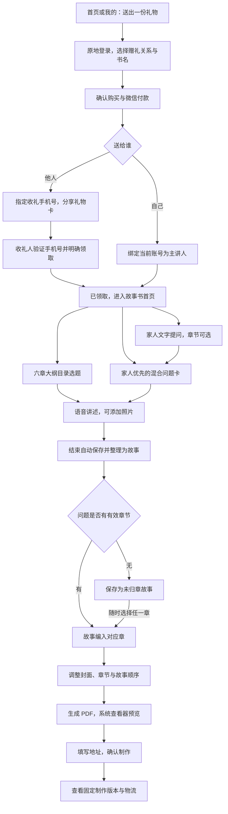

# 业务流程 · 2026-11-11

> 本文是最新版原画布对应的目标产品流程。2026-11-11 已对照当前小程序源码，实际能力与待调整项见[实现差异与功能清单](../../../docs/delivery/2026-11-11/miniprogram-design-gap.md)。本轮只更新文档，未实施业务代码或重新验证线上环境。
> 未选章节的回答直接保存为故事，随时可归入任一章节；不设成书前必须全部归章的门槛。

本文件对应新版画布的 71 张页面与状态、11 个分组；依据 ADR 0005、0008、0018、0020 及本轮确认需求。视觉参考与原型边界见 [README.md](README.md)。

## 主流程

受邀家人的入口是独立项目邀请：登录 → 填写相对主讲人的关系 → 接受加入 → 同一本故事书。它不经过礼物专属领取。未归章故事仍保留，不阻塞已经归章的内容生成 PDF；整本书没有入章故事时展示空稿状态。

## 角色标注

画板标题采用「序号 角色｜功能」，应用内部保留功能标题。购买者包含送给他人与送给自己两种情况；项目成员包含购买者、已领取礼物的收礼人、已加入的家人。受邀家人表示尚未接受邀请。登录状态用于区分「我的」等页面，既有成员资格不因查看其他项目或订单而改变。

| 标注角色 | 页面范围 |
| --- | --- |
| 所有人 | 首页、样书、条款 |
| 未登录用户 / 已登录用户 | 登录弹窗、我的、我的礼物 |
| 送礼人 / 购买者 | 统一购买入口、付款、礼物设置与分享；购买者可邀请家人 |
| 收礼人 | 礼物验证、接受、已领取、号码不匹配和旧卡失效 |
| 项目成员 | 项目、语音、故事、章节、书稿、制作与寄送 |
| 受邀家人 | 接受项目邀请及失效提示；无须恢复已删除的独立失效画板 |

## 送礼

首页／我的「送出一份礼物」 → 原地弹出微信手机号登录（如需）→ 必选赠礼关系与书名 → 确认购买 → 微信支付 → 创建同一项目与首本权益 → 指定收礼人微信绑定手机号 → 电子礼物卡 → 微信分享。送礼流程不设独立准备步骤；购买者可从「进入这本书」管理书名、故事和照片。

- 礼物仅由一位指定收礼人领取。收礼人同时是时光书主人公。
- 只有指定的已验证手机号可领取。验证匹配不自动领取，须明确接受。
- 更正手机号并重发后旧卡失效；旧卡展示「礼物卡已失效」，提示联系送礼人获取新卡片，不能继续领取。领取后不再更改收礼手机号。原领取者重新打开有效卡片进入原项目。
- 2026-11-11 确认移除语音祝福页面、同页文字留言及可选准备页，指定手机号后直接生成礼物卡。

## 登录弹窗

普通账号登录共用底部弹窗，背景保留发起页面；点击关闭留在原处。协议未勾选时，登录按钮仍可点击；点击后提示「继续登录表示同意协议」，用户点击「继续」即确认同意并直接继续微信手机号登录，无需返回勾选或再次点击登录。取消提示则留在登录弹窗，不提交同意或登录；已勾选时直接继续登录。查看条款后返回弹窗并保留待继续操作。成功后：送礼操作继续统一购买页，「我的」登录显示账号；普通首页登录进入故事书首页。独立 Login 画板仅展示首页上的弹窗状态，不再作为路由页面。交互复用现有 `miniprogram/components/quick-login`；本次协议交互为最新备注要求，画布交互与业务代码待同步。

## 收礼人与项目首页

礼物卡 → 授权微信手机号 → 匹配后明确接受礼物 → 礼物已领取 → 点击「进入项目」打开项目首页。删除独立的「录制第一个故事」页面及首页重复入口；首次录音和后续录音统一从项目首页开始。手机号不匹配时只能换账号或请送礼人核对，不能领取礼物。

故事书首页将问题与「开始讲述」放在同一卡片中，按钮随内容滚动，不固定在底部。删除独立的故事、书稿、照片三个按钮：故事数进入故事列表，照片数进入照片列表，书名、赠礼副标题与封面整块进入书稿；数量为 0 也可进入对应空状态。原声分钟数仅作统计，四舍五入为整数；非零不足一分钟显示「<1 分钟原声」，零录音显示「0 分钟原声」。书名下使用送礼人昵称与购买时的赠礼关系，不随查看者变化。

## 送给自己

统一送礼入口 → 登录（如需）→ 赠礼关系选「自己」→ 书名 → 确认购买与付款 → 自己的故事书首页。绑定当前登录账号，直接初始化六章六十题；没有收礼手机号、发卡或领取步骤。

同一本书同时在「我送出的」和「我收到的」显示，标记「送给自己」，内容与权益均不复制。历史待付款继续在送出类恢复；查看或取消旧订单不修改当前故事书名称和内容。

## 语音记录与故事

项目首页 → 开始讲述 → 开始录音。准备页包含无照片与有照片两种状态，可添加或移除本次讲述的照片，多张照片横向浏览。录音中添加照片先暂停，保留已录时长；继续后接着录制。照片随录音保存到故事中，移除只影响本次讲述的关联。

准备页的「换个问题」进入共用「大纲目录」，选择章节和问题后开始回答；也支持自由讲述。选题不是录音前必经步骤，不提供问题朗读功能。

单段 10 分钟，到时自动保存，同一故事可续录多段。录音中支持暂停、继续、结束；主动离开先提供保存选择。结束后自动保存和整理，无需用户分别提交封存/转写任务。

故事页呈现原声、整理后的正文和相关照片。主要补充方式为故事详情中的「继续讲述」；文字校对页只保留编辑和保存，补录仍从详情进入。整理后可入书，任一成员可编辑或移出成书章节。上传失败保留重试说明与入口，整理失败仍可回听原声。补录保留同一故事并累加原声时长，不提供换题入口；整理过程中切换项目，新内容仍保存回录音所属项目。

项目累计 6 小时；体验项目照片 40 张，首次整理/主动重整/追问为 30/30/90 次，自拟问题 2,000 字、故事标题 200 字（已确认现行额度，不增加购买或成书门槛）。画布不模拟额度扣减和平台上传。

## 项目照片

首页照片数量进入整本故事书的照片列表；数量为 0 时提供空状态和添加照片。允许先添加照片，再选择「讲讲这张照片」开始新故事，不要求先有一篇故事。讲述准备及录音暂停时可关联照片，故事详情也可事后补图。

照片列表、讲述照片和封面选择复用项目中的素材。移除本次讲述关联不等于删除整本书的原图，也不改变已冻结故事或 PDF。设计图中的人物和照片是示例，实际页面必须使用当前项目数据。

## 通用大纲与家人提问

一套通用大纲独立于赠礼关系，默认目录为「我的童年」「求学与成长」「初入社会」「亲密关系与家庭」「时光转折与重要经历」「现在的我与想留下的话」，每章十题，共六十题。章节可新增、改名、删除、排序，问题可新增、修改、移除、跳过或稍后回答。六十题正文为内容初稿，见 [OUTLINE-QUESTION-BANK.md](OUTLINE-QUESTION-BANK.md)。

大纲和书稿共用章节，章内区分问题与故事。选择问题 → 语音回答 → 保存录音并整理故事 → 回到故事；有章节时自动归入该章，已回答问题可直接查看关联故事。修改已回答问题的所属章节时，同步移动故事；问题删除不删除回答。

首页推荐同时包含家人问题与大纲题。进入故事书优先家人；换题按约两道家人题穿插一道大纲题，各类内随机且本轮不重复，一类不足时由另一类补足。已回答、已跳过不推荐；稍后回答本次先略过，再次进入故事书可重新出现。独立的家人提问列表仍可查看全部状态并主动选择回答。

家人问题在首页、列表、详情和讲述页显示「关系 · 昵称的提问」，例如「女儿 · 小雨的提问」。关系是提问人相对主讲人的称呼，始终跟随问题作者。购买者首次提问缺少关系时补填，后续沿用；不从赠礼关系反推。

家人提问由首页独立入口进入，只能手动输入文字。发布时章节可选，从章内发起默认带入，也能取消。发布 → 待回答 → 语音回答 → 已回答及关联故事；支持稍后回答、跳过和恢复，不增加购买者审核。

未选章节、自由讲述或原章节已删除的回答直接保存为普通故事，可从故事详情、未归章列表或任一章节的「本章故事」随时归章。未归章故事不阻塞已有内容生成书稿；PDF 只收录当前目录引用的故事，其余继续保留。明确暂不入书后也能重新归章。删除章节不删除录音和故事，章节中的家人问题保留为未选章节。

## 书稿与制作

故事 → 书稿概览 → 点击封面卡片编辑或进入章节管理 → 生成 PDF → 查看版本与页数 → 打开完整 PDF（微信文档查看器）→ 填写地址 → 使用首本权益提交制作 → 制作/寄送/交付。

一本书包含多个有序章节，每章包含多个有序故事；同一故事同时只属于一个章节，未入章的故事仍保留在项目。

章节管理可拖动整章，卡片按序展示前两篇故事与总数。编辑章节负责名称与故事正文；点击「本章故事」后，可拖动故事、移出故事，或从项目故事中选择。「加入本章」用于尚未入书的故事，「移到本章」会同时从原章节移出。移出故事只删除章节引用；移除整章需确认，原故事仍保留。

行为依据：小程序 `pages/directory`、`pages/chapter`、`pages/chapter-stories` 与 `components/sort-list`；原型使用稳定的章节 key 和有序 storyRefs 对齐实现。

章节管理负责章节名称、顺序与故事归属，PDF 目录展示该次生成的结构与页码；共用同一套目录数据，不新增另一套目录编辑功能。PDF 内目录为只读内容，不在小程序设计自定义翻页或目录跳转按钮。

书名、寄语和封面照片作为同次编辑，点击保存后生效；选图返回仍是编辑草稿，直接返回放弃未保存修改。只有当前就绪 PDF 可预览或提交制作；尚未生成、封面/章节/内容已修改时需要先生成或重新生成。提交制作保留对应版本，后续编辑或重新生成不改写已提交文件；返回书稿显示「查看制作进度」，可查看当时提交的版本。取消逐页勾选、双方确认与手写核对；制作进度与订单付款分开。

书中原声：扫描 PDF/纸书中的二维码 → 登录（如需）→ 校验项目访问权限 → 回听该故事版本的原声。二维码为图片入口，不提供 PDF 内直接播放或点击跳转；原声页可独立打开，不依赖返回书稿。设计二维码仅为示意，未接真实音频。

## 项目、家人和我的

顶层保留时光故事、我的。「我的礼物」分我送出的、我收到的、我参与的，切换故事书同步使用这三类；待付款位于送出类。书名下显示送礼人昵称与原始赠礼关系，不随查看者改变。项目内进入故事、书稿、照片、大纲目录和家人提问，始终突出语音记录。家庭协作由项目购买者发起邀请；收礼人和已加入家人不显示邀请入口。受邀家人填写「你是主讲人的谁」并明确接受后成为完整成员，可记录、编辑和安排制作，与礼物专属领取分开。邀请权限对齐 `apps/api/src/identity/participation.ts` 的 initiatorUserId 校验与 canInvite。我的提供昵称修改、项目入口、购买入口和现行使用条款。

## 状态与返回规则

| 场景 | 结果与下一步 |
| --- | --- |
| 登录关闭／查看条款返回 | 关闭停留发起页；条款返回恢复弹窗与原操作，登录本身不发起购买或领取。 |
| 待付款／付款结果未知 | 从送出类恢复原单；未知先查询，不重复创建订单或权益。新购与旧单隔离。 |
| 收礼号码不匹配／旧卡失效 | 不能领取；不匹配可换账号或联系送礼人核对，旧卡提示获取新卡。 |
| 已领取／重复打开 | 原收礼人进入原故事书，不重复领礼或建项目；领取后不再修改号码。 |
| 问题稍后回答／跳过 | 稍后本次推荐略过、下次进入可出现；跳过不推荐，可从列表恢复。 |
| 录音上传失败／整理失败 | 保留已有素材并给重试；已保存原声可回听，重新整理不要求重录。 |
| 删除章节／移除问题 | 保留录音和故事；故事可重新归章，章节内家人问题变为未选章节。 |
| 无入章故事／存在未归章故事 | 无入章故事展示空稿；已有入章内容可生成，未归章故事不被默认收进第一章。 |
| 修改封面／入书正文／顺序 | 当前书稿待更新，需要重新生成；只改未来问题文字不改已生成正文。 |
| 制作提交未知／已提交／已取消 | 未知先查询；已提交查看固定版本与进度；确认取消后才可修改重提。 |

## 页面与手机交互

应用只保留「时光故事」「我的」两个顶层 Tab；页面、卡片、返回按钮和底部操作区统一白色，橄榄绿主色与局部浅绿沿用。导航使用功能标题，正文不重复同名标题；书名、故事名和问题正文完整保留。

同一功能避免重复按钮：书稿封面整卡编辑，已回答问题的故事卡整块进入故事，文字校对只编辑和保存。普通页面通过导航返回，不叠加无必要的底部返回；表单保存、录音控制及制作提交保留必要操作区。首页开始讲述随问题卡滚动。

手机检查覆盖 320px／390px、长文换行、键盘出现、底部安全区和滚动可达；主要按钮约 52px，图标按钮至少 44px。所有回听入口使用播放／暂停与可拖动进度条，显示已播放和总时长。首次加载使用结构化骨架，提交与媒体读取采用局部反馈；刷新不清空已显示内容。

## 与当前实现的衔接

本次基于正式小程序路径及相关 API 完成对照，见[18 项调整清单与代码依据](../../../docs/delivery/2026-11-11/miniprogram-design-gap.md)。登录、录音保存、音频进度条、章节拖动、PDF 和制作基础可复用；礼物身份、家人问题、共用章节、项目照片与归章逻辑需要业务改造。71 张画板是页面与状态，不要求分别创建 71 条路由。

## 设计与验收分开

画布演示不代表微信授权、收款、真实麦克风、语音转写、分享、发货已经实现。独立画板展示错误/处理中/制作等分支；点击主稿可体验样例主线。浏览器走查结果见 [REVIEW.md](REVIEW.md)。
