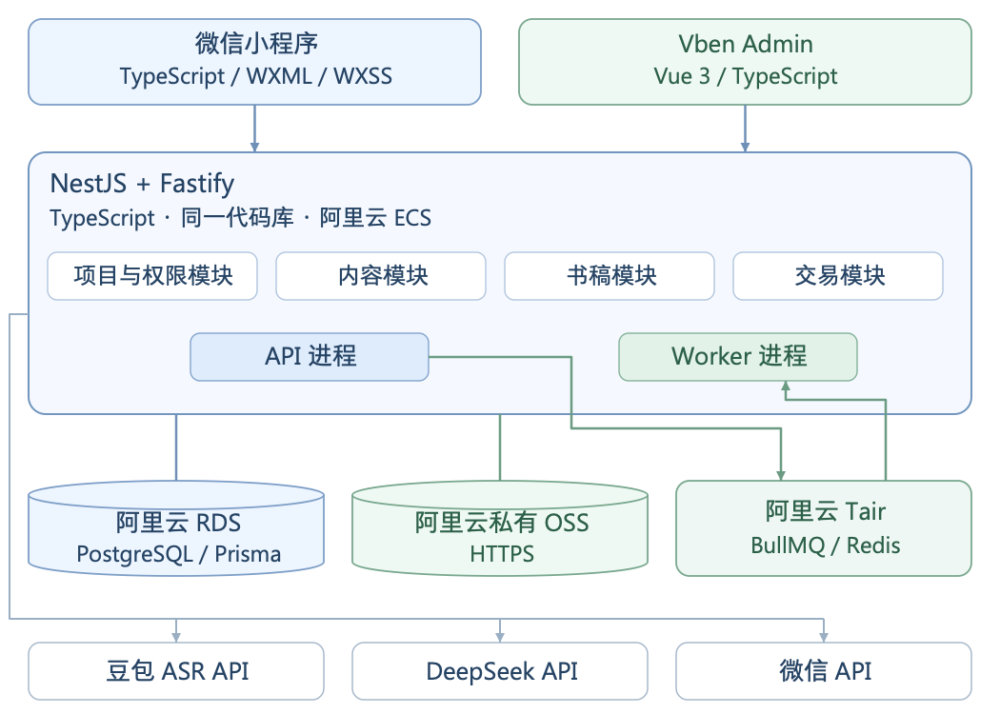

# 岁月成书 MVP 技术架构图

2026年10月20日 · 技术方案，尚未完成后端接入验证。

**一套 NestJS 后端、四个业务模块、一套 BullMQ 后台任务机制。** 原生微信小程序、Vben 管理端、阿里云基础服务、豆包文件转写与 DeepSeek 文本模型沿用既定选型。

可编辑图源：[SVG](diagrams/mvp-architecture.svg)。

| 模块 | 负责内容 |
| --- | --- |
| 项目与权限 | 发起人、讲述者、动态赠礼关系、个人大纲与问题、查看和处理资料的许可 |
| 录音与故事 | 录音与照片保存、文件转写、可选追问、故事草稿与本人确认 |
| 书稿与确认 | 章节编排、固定模板 PDF、整书确认与确认文件记录 |
| 订单与交付 | 微信支付核验、首本权益、人工交付印厂、物流与退款 |

API 和后台处理来自同一仓库、同一发布包，共用四个模块；首版在阿里云 ECS 上运行两个进程。PDF 由后台处理调用受资源限制的 Chromium 子进程生成。资料是否足够、全书是否连贯及事实是否一致，由发起人与运营协助检查，讲述者确认内容。

## 后台处理规则

1. **数据库保存业务进度。** 录音、故事、书稿记录各自的输入版本、处理阶段、供应商请求编号和最终结果；数据库登记已校验的录音文件与待转写进度在同一次事务完成，之后加入队列。
2. **BullMQ 统一安排执行、等待和有限重试。** 任务编号由业务记录、操作类型与输入版本确定；普通失败只由 BullMQ 重试，不另建业务重试循环。豆包仍在处理时，按原请求编号延后查询。
3. **一个恢复检查补回遗漏。** 定时检查数据库中未完成的工作，只有队列中没有对应工作且未达到重试上限时才补回；队列历史丢失且不能确定已尝试次数的工作转人工处理，避免无限重试。
4. **重复执行不能产生重复结果。** 数据库用唯一约束和更新条件检查输入版本、处理编号与当前许可，旧结果不能覆盖新内容；供应商提交结果不确定时先查原请求，不能查询的转人工处理。不能承诺外部请求只发生一次。

首版不另建通用业务任务表、处理尝试表、Outbox 投递系统、通用通知 Inbox 或独立 PDF 服务。运行日志记录错误、耗时与费用信息；录音、故事、订单保留必要的业务记录。

## 必须保留的约束

- 原声与照片保存到阿里云私有 OSS，后端检查文件后才显示云端已保存；ASR 失败可沿用原声，不要求重录。录音时不做实时转写。
- 微信支付通知经后端核验后，在一个数据库事务内更新订单、项目和首本权益，保存成功才回复收到；查单走同一规则，重复通知不重复开通。
- 大纲和问题由双方调整，讲述者决定回答、跳过和入书；修改已确认内容后重新确认。用户确认和交给印厂的是同一份 PDF。
- 各模块只通过固定入口修改数据；豆包和 DeepSeek 只能经录音与故事模块调用，印刷提交只能经书稿与订单模块核对。代码检查禁止跨模块直接访问内部实现，后台处理也必须调用相同入口。

## 评审需确定

豆包标准版或极速版及等待时间；DeepSeek 具体型号与每篇费用；人工编辑范围与工时；固定书稿尺寸与样书效果；阿里云实际规格与预算。故障验证至少覆盖：入队前服务中断、重复执行、队列历史丢失、供应商结果未知、改稿后旧结果返回，以及重复支付通知。

参考：[BullMQ 任务重试](https://docs.bullmq.io/guide/retrying-failing-jobs)、[任务重复执行](https://docs.bullmq.io/patterns/idempotent-jobs)、[任务清理与编号去重](https://docs.bullmq.io/guide/queues/auto-removal-of-jobs)。
