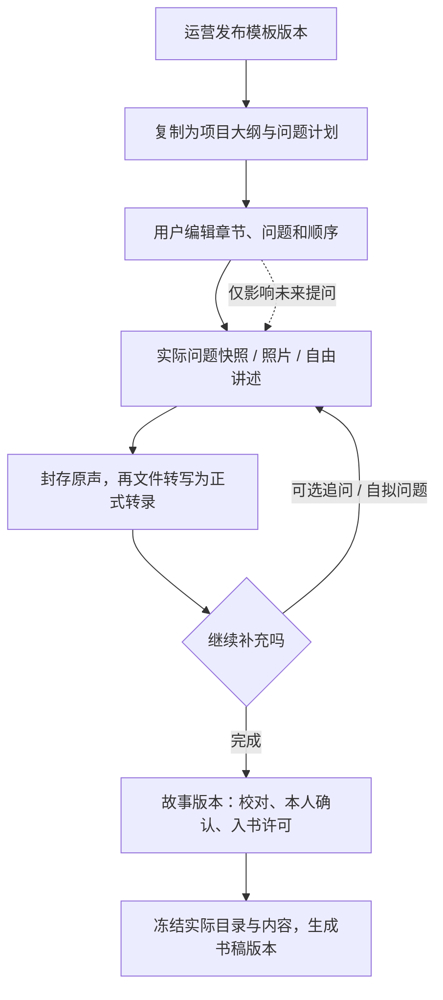

# 项目大纲、问题计划与追问

版本：V1.0 · 2026年10月20日 · 定稿。本文定义[技术架构](技术架构.md)第8节的模板、个人计划、问题与追问规则；具体模板内容及质量阈值按D09完成审校和试用。

已确认：内置多份大纲；用户可按个人情况回答，也可增删改大纲和问题；发起人与讲述者均可编辑，讲述者决定是否回答和入书。一次只呈现一个问题；录音结束可靠保存后异步转写，转录就绪再给可选追问。

## 1. 从内容模板到一本书



模板是内容起点，项目计划是采访安排，书稿目录是一次交付结果。三者分别保存；没有回答的问题不是缺失章节，也不生成填充故事。首次录音前不强迫用户编辑计划。

## 2. 内置模板结构

| 模板           | 可选章节示例                                                     | 使用约束                                           |
| -------------- | ---------------------------------------------------------------- | -------------------------------------------------- |
| 完整人生回忆   | 成长地方、求学与探索、工作与选择、重要的人、日常爱好、想留下的话 | 章节可停用；婚恋和育儿不设为默认必答               |
| 一段人生阶段   | 起点、当时生活、关键片段、变化、今天回看                         | 适合退休、求学、搬迁等，不能默认关系类型对应某阶段 |
| 主题与共同经历 | 相识、共同日常、一个难忘片段、彼此影响、未来寄语                 | 每个项目仍一位讲述者；不收集另一人代述并冒充原声   |

正式章节与题目按以上结构由内容运营原创或取得授权，并完成审校。关系类型仅影响推荐顺序，用户可以选择任一模板或从空白计划起步。空白计划也提供照片/自由讲述入口和通用起讲题。

问题库记录 `intent / optional_context / sensitivity_tags / followup_candidates / locale`；不要只存一串问题文本。适用条件使用用户主动填写的可选偏好，状态包含“未知”，不能从称呼推断性别、婚姻、生育、职业、亲人是否健在。

## 3. 编辑、发布与个人定制

| 动作                                 | 允许者                       | 结果                                                  |
| ------------------------------------ | ---------------------------- | ----------------------------------------------------- |
| 编辑、发布全局模板                   | 内容运营                     | 草稿可改，发布生成不可变版本；下架不删除已复制项目    |
| 选模板、增删/改名/排序章节           | 讲述者、经授权发起人         | 创建新项目大纲版本，保留历史                          |
| 新增、改写、重排问题                 | 同上                         | 变更未来计划；保存作者和来源，不覆盖实际提问快照      |
| 不适用、稍后回答、跳过、不再问某主题 | 讲述者或有证据的本人协助流程 | 分别存状态；不适用/禁问不能被发起人后续换模板静默重置 |
| 重新启用本人禁问主题                 | 讲述者或有证据的本人协助流程 | 显式动作并留记录，不从付款身份推定同意                |
| 改写模型建议、自己提一个问题         | 讲述者、经授权发起人         | 作为实际自定义问题记录；不要求模型审核用户人生选择    |
| 确认内容和允许入书                   | 讲述者或核验协助             | 绑定确定故事版本，其他编辑权不替代此权利              |

所有编辑检查授权与 `expectedVersion`，并发冲突提示刷新/比较，不静默后写覆盖。大纲与问题一次编辑以同一 `plan_revision` 提交，避免章节已删除但题目仍指向旧章节。

“删章节”是移出计划，不删除既有录音/故事；已有故事可移到用户选择的章节或“待归类”。不适用不计未完成，不强制答完某比例；用户可主动重新回答，但保留旧录音和实际问法。草稿导出可包含计划，正式资料包仍以授权范围为准。

更换模板显示差异并经用户选择合并/替换未来计划；默认保留个人新增问题、已回答关联和禁问偏好。不得整表覆盖个人计划，也不自动批量请求ASR/LLM。

## 4. 基础问题设计

每题围绕一个可回忆的场景，用短句和口语，避开“请系统评价你一生”之类大命题。给出可选方向，允许“记不清”“没有这段经历”“不想谈”。用词跟随用户称呼，人物关系须来自其说明。

| 问题目的       | 基础问题示例                           | 可能追问                     | 退出条件                 |
| -------------- | -------------------------------------- | ---------------------------- | ------------------------ |
| 找一个具体场景 | 小时候住的地方，哪一处让你记得最清楚？ | 站在那里时，你常会看到什么？ | 已有足够细节或用户想换题 |
| 描述一次选择   | 有没有一次选择，让后来的生活变了样？   | 当时最让你犹豫的是什么？     | 用户不想谈原因则停止     |
| 留下重要的人   | 有谁让你一直记在心里？                 | 有哪件小事让你记住了这个人？ | 不预设健在、亲属或性别   |
| 记录日常       | 那段时间里，平常的一天是怎样过的？     | 一天中有没有特别喜欢的时刻？ | 不暗示必须积极快乐       |
| 表达本人含义   | 今天回想这件事，你最想留下什么？       | 可直接完成，无须再追问       | 已表达完整或主动结束     |

例题用于定义问题结构，正式内容须完成目标用户试用。照片起讲先问“你愿意说说这张照片吗？”，人物、地点和年代由本人说明；不以视觉模型识别结果补事实。

## 5. 有界追问策略

输入仅包含当前问题及目的、当前故事的正式转录、当前故事的问题历史、用户明确偏好和计划中相关章节摘要。跨故事正文检索、持续人格画像、自主工具规划不在MVP范围。

决策顺序：本人结束/拒答/禁问 → 当前目的是否已有足够回答 → 是否重复 → 是否有一个值得补充的缺口 → 选经审校候选或生成一条。生成失败时可用通用题或结束，已经保存的素材始终可以整理。

追问由DeepSeek按以下契约输出：

```json
{
  "action": "ask",
  "question": "你还记得外婆早起时会做什么吗？",
  "intent": "specific_detail",
  "sourceRefs": ["transcript:tr_01:segment_03"],
  "reasonCode": "DETAIL_AVAILABLE"
}
```

`sourceRefs`必须来自当前正式转录或用户说明，未知引用拒绝；“有引用”仍需人工评测真实性。内部原因不用技术标签展示给用户。不能生成包含预设答案的问法，例如把“外婆早起”改成“外婆是不是每天早起给你做饭？”；不能逼问创伤或已跳过主题。事实矛盾进入待核对项，用户选择澄清或保留不确定，不由模型裁决。

每次只显示一条建议，提供“说一点”“换一个”“跳过/完成”。建议初始每故事最多主动推荐3次，转录就绪后追问任务响应P95≤5秒，均为待试用目标；此时延不包含上传和文件转写，停录后不承诺立即有追问。等待期间提供继续补录或完成入口，超时给出明确下一步；迟到建议不能覆盖新问题。用户主动补录不受该推荐次数限制，销售录音额度另按D04。

追问任务冻结 `plan_revision / question_snapshot / transcript_ids / preference_version / access_epoch`。结果回来后检查当前采访、问题与偏好版本；已结束、已换题、已禁问、已撤回的结果作废。输入中的文字只作为内容，不能覆盖系统规则或调用支付/权限工具。

## 6. 变更传播

| 变更                         | 故事确认           | 待生产书稿               | 转写/生成                        |
| ---------------------------- | ------------------ | ------------------------ | -------------------------------- |
| 未来问题措辞、顺序、停用     | 保留               | 未改变实际入书内容时保留 | 不重转写；未完成追问按旧输入作废 |
| 删除含已有故事的计划章节     | 保留故事及素材     | 入书目录变化则失效       | 用户决定新归属；不丢故事         |
| 调整入书章节标题、顺序、归属 | 保留未改正文的确认 | 新书稿、重新确认         | 重渲染，不重跑ASR                |
| 故事正文、照片或录音清单变化 | 新故事版本需重确认 | 相关待生产书稿失效       | 仅重做受影响环节                 |
| 运营发布新版模板             | 不变               | 不变                     | 项目不自动迁移                   |

已投产/已交付版本保持固定，变更按原生产与售后边界处理。

## 7. 内容评测和验收

X05/X06覆盖：默认模板直接开讲、空白计划、两角色编辑及冲突、自由讲述、照片起讲、跳过不适用、禁问保留、改题不改历史、模板更新不覆盖、空章节不填假文、目录调整重新确认。

固定测试样本包括短回答、长停顿、口音转错、模糊年份、重复、矛盾、“没有孩子”“不想谈工作”“已经说完”、自定义亲友关系、偏离原题的真实回忆，以及转录中的提示词注入。人工评价相关性、是否诱导、是否重复、一次是否只问一件事、尊重拒答、事实来源、完成负担和最终故事可用性。

样本按关系类型、选用模板及实际经历覆盖，不按“父亲/母亲”分两套业务规则。任何禁止内容被重新追问、跳过被当欠答、模板升级覆盖个人修改或问题改写破坏原声来源，均为上线阻断。具体试用人数、质量阈值和内容负责人记录在D09，未验证不宣传个性化提问质量。
