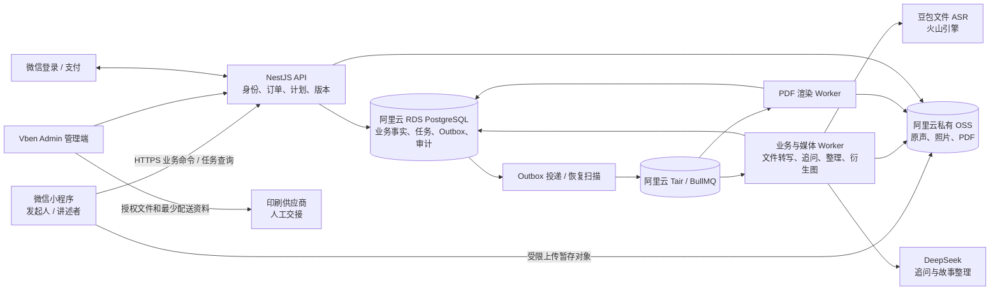

# 岁月成书 MVP 技术架构

> 2026-10-22 MVP 范围更新：[ADR 0008](../adr/0008-single-builtin-template.md) 将模板改为后端内置一套固定版本；运营模板创建/编辑/发布、多模板选择/推荐/切换推迟。个人大纲和问题仍可编辑。下文原多模板设计保留为后续参考，以此更新为准。

版本：V1.0 · 2026年10月20日 · 定稿。依据：[MVP PRD](../时光里_岁月成书_MVP_PRD.md)、[业务术语](../../GLOSSARY.md)。本文定义目标架构，运行配置与上线验证见[决策与待定项](决策与待定项.md)。

**采用 TypeScript / NestJS 模块化单体，围绕“录音 → 可靠保存 → 文件转写 → 可选追问 → 故事确认”交付首版。** 原声与照片封存至阿里云私有OSS；阿里云RDS PostgreSQL保存业务事实、版本和确认，Tair（兼容Redis）/ BullMQ调度转写、追问、整理与PDF任务。产品支持动态赠礼关系、项目大纲和问题编辑。

产品采用可配置赠礼关系与可编辑个人大纲：发起人与讲述者均可调整章节和问题，讲述者决定是否回答及入书。一个项目对应一位成年讲述者、一位发起人与一本首本实体书。基础云服务使用阿里云，文件ASR首选豆包，文本模型首选DeepSeek，后端工程以wutong-admin为主要参考。

当前已有15页原生小程序前端与浏览器预览，使用本机数据；`Recipient` 仍为妈妈/爸爸、题目为静态数组，录音为16kHz单声道MP3且只保存本机文件。后端、文件转写、云存储与支付均未接入。本文不将建议接口或真机待验收项描述为已实现。现状依据：[领域模型](../../miniprogram/domain/model.ts)、[录音控制器](../../miniprogram/services/recorder.ts)、[前端说明](../frontend/README.md)。

## 1. 首版范围与取舍

| 需求               | 实现边界                                                   | 对用户的结果                                       |
| ------------------ | ---------------------------------------------------------- | -------------------------------------------------- |
| 可靠录音与故事整理 | 停录后先持久化本地文件，再上传、校验、封存；每片段异步转写 | 保存失败可重试；转写失败保留原声，无需重录         |
| 停录后可选追问     | 当前片段云端保存且转录就绪后提出一条问题                   | 可等待、继续补录、跳过或直接提交整理，不强迫停留   |
| 动态赠礼对象       | 可发布关系类型，用户可填写自定义称呼                       | 不以父母/子女作为唯一身份，不预设人生经历          |
| 可修改大纲与问题   | 模板复制为个人计划，实际提问保存快照                       | 双方可编辑，讲述者决定回答和入书，修改不丢历史素材 |
| 图片与支付         | 私有原图/衍生图；支付通知和查单由后端核验                  | 书稿使用确定素材，退出后可恢复同一项目和权益       |

文件转写是唯一转写路径。录音中显示问题与计时，停录后保存文件并异步处理；文字和追问的返回时延以实测为准。API、任务Worker和PDF渲染器分角色运行。

核心链路为“真实原声 → 经本人确认的故事 → 确定书稿 → 同一版本实体交付”。录音处理原则见[ADR 0006](../adr/0006-file-asr-after-save.md)。

## 2. 系统结构与进程

API、业务Worker和渲染器是同一模块化单体的进程角色，共用领域规则和数据库。API受理命令与查询，Worker执行耗时任务，PDF始终限制资源；鉴权文件网关用于读取已保存素材，不承担音频实时转发。队列丢失可从数据库任务恢复，不能把Redis当保存成功证据。

文件ASR仅取得授权的已封存音频，文本模型仅取得当前任务必要内容，印厂只取得授权生产文件和配送资料。外部供应商不连接业务数据库。

## 3. 技术选型、阿里云与wutong对齐

工程基线采用本地`wutong-admin`的NestJS/Vben路线。[wutong技术栈对齐](wutong技术栈对齐.md)列出源码、依赖声明与部署模板依据；参考项目的线上运行状态不作为TimeNook验收依据。

| 层次       | TimeNook方案                                 | 对齐与边界                                                                                 |
| ---------- | -------------------------------------------- | ------------------------------------------------------------------------------------------ |
| 用户端     | 原生微信小程序，TypeScript / WXML / WXSS     | 录音、图片、登录和支付使用微信API；不改为跨端App                                           |
| 管理端     | Vben Admin的web-antd工程路线                 | 对齐wutong的Vben请求、表单/表格、权限与布局组织；业务菜单独立                              |
| 后端       | NestJS + Fastify，TypeScript，REST + OpenAPI | 对齐FastifyAdapter、DTO校验/Swagger；保留TimeNook授权与接口契约                            |
| 数据       | 阿里云RDS PostgreSQL + Prisma                | PostgreSQL事务、外键、唯一约束和锁；优先评估16系支持规格，版本开工锁定                     |
| 调度       | BullMQ + ioredis，阿里云Tair（兼容Redis）    | 先评估Redis 7兼容标准架构，验证Lua/阻塞命令与noeviction；业务任务/Outbox在RDS              |
| 文件       | 阿里云私有OSS + RAM/STS                      | 暂存、最终、衍生对象分权；用户经鉴权网关读取，云密钥只在服务端                             |
| 文件ASR    | 豆包录音文件识别（火山引擎）                 | 对已封存文件异步提交/查询，固定服务资源、请求ID与配置版本；实测短片段质量与时延            |
| 文本模型   | DeepSeek官方文本API                          | 当前故事的可选追问和结构化整理；具体模型经评测锁定，记录模型/提示词版本及用量              |
| 排版       | Node.js + Playwright / Chromium固定模板      | 渲染独立限资源，保留固定容器与字体环境；印厂格式需真实打样                                 |
| 计算与交付 | 阿里云ECS + Nginx + systemd，CI构建release包 | 对齐releases/current/shared和API/Worker分进程；PDF容器可独立管理，多副本再接ALB            |
| 观测与工程 | 云监控/SLS；pnpm workspace + contracts       | 参考Node 22系、pnpm 10、NestJS 11/Fastify 5、Prisma 6/BullMQ 5家族；开工锁兼容补丁和锁文件 |

**对齐技术和工程习惯，TimeNook使用独立数据库/账号、Bucket、队列空间与凭据。** 是否复用物理资源须另行做隔离/配额评估。不能从“参考wutong”推导为复用用户库、商户、飞书登录或公共CDN。关键业务任务在数据库持久化，不照搬参考项目部分Redis短期任务记录。

工程目录采用`apps/api`（main/worker入口）、`apps/web-antd`、`packages/contracts`，小程序与渲染器作为独立应用；初始化后端时按兼容方案迁入pnpm workspace。目标布局和运行验证见[对齐依据](wutong技术栈对齐.md)，基础服务原则见[ADR 0007](../adr/0007-aliyun-and-wutong-stack.md)。

## 4. 角色与动态赠礼对象

### 4.1 关系类型不承担身份或授权

发起人是购买/组织项目的人，讲述者是书中主人公，操作人是实际使用设备的人。父母、祖辈、伴侣、朋友、老师等是发起人与讲述者的关系示例。**类型可动态增加，用户也可填写自定义称呼；不在代码中以 `mother | father` 封闭枚举。**

服务端维护 `recipient_types`：稳定code、显示名称、启用状态、顺序和可推荐模板；项目保存可空类型引用与自己的关系称呼。自定义称呼不自动新增全站类型。订单冻结购买时的类型code/称呼快照；停用或重命名类型不修改已购项目。项目称呼、姓名、书名可选修改，通用书名兜底为“我的时光手记”。

类型不绑定套餐、价格、性别、是否有子女或必须回答的章节。同一个“朋友”类型可用完整人生大纲，也可选择某段经历；称呼修改不更换 `subject_id`。替换书的主人公属于独立核验流程，不能通过改称呼绕过原主体授权。

### 4.2 权限与支持范围

一个项目仍只有一位讲述者、一位发起人。两者均可修改项目大纲与问题；发起人访问私人素材须经授权，讲述者可跳题、拒答、撤回以及决定入书。修改计划不使发起人获得代确认权限。邀请和同机协助使用“发起人/讲述者”语义，不要求双方是子女/父母。

首版采用成年人本人讲述的授权路径。类型可配置不自动开启未成年人、逝者纪念、多主人公合著或本人自购模式；这些场景的角色/授权证据另见待定项。若未来支持本人自购，需显式定义同一账号承担两角色的流程，不能假装发出并接受自己的邀请。

## 5. 微信录音、可靠保存与文件转写

### 5.1 录音先形成文件

小程序使用`RecorderManager`完成一次录音，停止后保存真实文件及本地上传清单。采集参数以16kHz、单声道、48kbps MP3为验证起点；段长初始建议1–5分钟，格式、码率和最大时长需目标iOS/Android真机验证。平台单次10分钟上限不是产品承诺或套餐额度。[录音参数](https://developers.weixin.qq.com/miniprogram/dev/api/media/recorder/RecorderManager.start.html)

录音中仅显示当前问题、计时和停止按钮。结束时将临时文件转存到持久本地路径；清单包含当前账号、项目、采访、实际问题、client_clip_id、本地文件和上传状态。少量元数据放Storage，音频保存在文件系统；本地保存失败明确提示“请先别退出”，不继续宣称已保存。

来电、微信通话、暂停、切后台和返回由独立录音控制器处理，不自动重启麦克风。系统强杀可能没有结束回调，恢复只承诺实际已保存文件；已云端封存素材不因客户端退出而丢失。平台隐私授权、麦克风权限与讲述者采集/AI同意分别满足。[录音系统占用事件](https://developers.weixin.qq.com/miniprogram/dev/api/media/recorder/RecorderManager.onInterruptionBegin.html)

### 5.2 保存与转写任务

1. 停录后持久化本地文件与稳定片段ID，向API请求上传会话和受限暂存凭证。
2. 文件直传私有暂存区，服务端核验存在、大小、类型、可解码、时长及hash，复制并复验最终对象。
3. 同事务记录封存资产/录音片段、结算上传额度、创建文件转写任务与Outbox；返回sealed后才显示“云端已保存”。复制成功但落库失败的对象由延迟清理与重试处理。
4. Worker读取固定资产和授权epoch，调用豆包文件ASR；先保存稳定的供应商请求UUID、服务资源、模型/API配置版本与提交状态，再发起外部请求。异步等待由调度器查询，释放Worker，不占用HTTP请求等待结果。
5. 结果返回时核对任务租约/fence、授权与输入hash，保存不可变原始转录并标记该片段转写完成。重复完成不新增有效转录，空白/无有效语音给出可重试或换题提示，不据空文本生成故事。
6. 用户提交整理时冻结该故事全部已保存片段；缺少转录的片段仍是任务依赖，全部就绪后才整理。新补录/改稿期间返回的旧结果不能覆盖新版本。

豆包录音文件识别按文件URL异步提交/查询，首选标准版路径。服务端为已封存OSS音频签发仅供供应商读取的限时URL；火山引擎需要可从公网访问的HTTPS源地址，不能使用阿里云内网Endpoint。签名有效期与STS剩余有效期覆盖实际取源窗口；URL不在客户端、日志或分享页公开。服务端及时持久化结果，以自有任务ID映射供应商请求UUID，不混用不同产品的鉴权、状态码或资源ID。[豆包文件识别接口](https://docs.volcengine.com/docs/DoubaoVoice/LargemodelrecordingfilerecognitionstandardversionAPI?lang=zh)

异步标准版的供应商处理时限不等于本产品的出稿指标。S0须验证1–5分钟短片段的总耗时、口音质量和费用，确定具体资源与模型配置；如需其他文件识别规格，评测通过后显式配置，不自动切换供应商。

### 5.3 等待、追问与失败恢复

分别维护设备录音、本地保存、上传封存、转写和故事整理状态。界面区分“已保存在本机”“云端已保存”“正在整理文字”；原声保存成功不等于文字已生成。用户可继续补录、回听、提交整理或离开，返回后恢复原采访和任务。

只有当前实际问题所需片段已封存且转录就绪，才请求可选追问；等待时可用原问题继续讲、换题或选择完成，不强迫等待。追问输入固定问题/转录/偏好版本，用户已换题、结束或撤回后迟到结果作废，不突然替换屏幕。推荐时延单独统计“转录就绪后到追问返回”，不当作停录到追问的承诺。

上传失败用本地文件重试；转写/整理失败从封存文件重试，沿用原业务任务与用户额度。供应商结果未知时先查原任务，不盲目重复提交。页面可见时用HTTPS轮询任务，建议2秒起退避至10秒，切后台暂停，返回立即刷新；不需要长连接和音频流状态。

保留≤5分钟输入95%在3分钟内出稿的内部试点目标，从用户提交整理且输入均已云端保存起算，包含排队及依赖转写；失败率/人工接管率单列。尚未结束的供应商任务继续显示“处理中，可离开”，不因超出显示等待预算就伪写失败或重复提交；最终业务截止时间另行配置。该目标须按豆包实际短音频测试校准。

## 6. 图片与音频存储

小程序以 `wx.chooseMedia` 选择图片，优先取得可用原图，选择失败/低清照片不等于云端已有文件。`wx.compressImage`可做预览优化，不能用低清预览覆盖唯一印刷素材；其格式能力存在平台差异。[chooseMedia](https://developers.weixin.qq.com/miniprogram/dev/api/media/video/wx.chooseMedia.html)、[compressImage](https://developers.weixin.qq.com/miniprogram/dev/api/media/image/wx.compressImage.html)

统一保存链路为：创建上传会话与额度预留 → 私有暂存区直传 → 服务端真实格式/体积/像素或时长/可解码/hash校验 → 复制到客户端不可写的最终key并复验 → 同事务关联资产与片段 → 返回封存成功。客户端上传HTTP成功不等于封存；临时凭证按当前对象/最小动作/短有效期限定，永久云密钥不下发。凭证无法保证的大小/类型限制必须在封存时执行。[OSS PostObject](https://help.aliyun.com/zh/oss/developer-reference/postobject)、[POST V4](https://help.aliyun.com/zh/oss/developer-reference/signature-version-4-recommend)

小程序直传建议由API生成精确key、content-length-range和过期时间的PostObject V4授权表单，wx.uploadFile只写暂存区；后端通过RAM角色/受限STS签名。若后续采用分片上传，另配对应动作权限并实测，不把普通表单上传称为断点续传。OSS返回成功后仍执行本项目封存，不用存储回调单独授予素材可用状态。

- 原声采集文件、必要回听衍生音频；原图、旋转校正图、预览图和印刷图分别记录父子资产关系与处理版本。EXIF方位先正确应用，衍生图去除不必要的定位元数据；原图按告知范围保存。
- 服务端限制解码像素及内存，验证JPEG/PNG及候选HEIC转换链路；按实际印刷尺寸评估清晰度，低清提示由用户换图/缩小排版，模型不补造人物或年代。
- 多图上传逐文件记录进度和重试；幂等键及封存规则避免重复资产。断点续传能力须按选用SDK实测，最小可靠策略为按文件重试，不宣传未实现的字节级续传。
- 受控读取经鉴权媒体网关，照片缩略图也不公开。图片、音频和PDF均携带产品会话下载至临时文件，再交图片组件/播放器/预览器；不假设这些组件的src可设置Authorization。授权撤回关闭新请求及活动流并清理受控缓存。
- 暂存、最终、衍生、导出及历史对象版本统一纳入D03生命周期和删除台账。更换照片、裁切、说明或入书顺序产生新故事/书稿版本。

## 7. 支付与实体书权益

候选路径是普通商户的小程序JSAPI支付：绑定匹配的AppID/商户号，服务端用本小程序openid下单，返回经过服务端签名的支付参数，小程序调起 `wx.requestPayment`。如采用服务商/子商户模式，另行选择相应接口与签名配置；不混用两种路径。[小程序支付接入](https://pay.wechatpay.cn/doc/v3/merchant/4012791897)

服务端冻结 `package_version`、99900分金额、币种、条款、赠礼关系快照和商户单号；回调验签/解密并核对AppID、商户、订单、金额、币种、交易状态。已验证通知先持久化Inbox再应答，后续与查单共用幂等入账用例：**付款、默认项目/讲述者、默认大纲及首本权益在同一事务激活一次**。前端支付成功、取消、超时都回服务端查询，不用客户端状态授予权益。

主动查单处理通知遗漏和退出恢复；关单与成功支付竞态保留真实支付事实。退款固定商户退款单号，锁订单预留可退金额，结果未知时查原退款；退款权益影响按公示规则处理。提交首本不再次付款，印厂只接收已确认版本。细节及端点见[流程与接口](流程与接口.md)。

999元包含数字制作、资料服务和实体书，**实际销售分类、类目、商户资质、订单发货管理以及iOS/Android可用路径须以真实账号和平台审核结果确定**。不能因为最终有纸书就认定整套数字服务已获支付准入；D08未闭合时不开正式售卖。

## 8. 大纲、问题与追问设计

### 8.1 四层内容模型

| 层             | 保存内容                                                   | 变更规则                                                         |
| -------------- | ---------------------------------------------------------- | ---------------------------------------------------------------- |
| 内置模板版本   | 适用主题、章节、问题目的、基础问题、可选分支、敏感提示     | 编辑草稿后发布不可变版本；项目引用当时版本，不随运营更新改变     |
| 项目大纲版本   | 用户选定/复制后的章节标题、顺序、启停及自定义章节          | 发起人/讲述者可修改、增删、排序；服务端检查授权与expectedVersion |
| 项目问题计划   | 章节关联、问题文本、目的、自定义来源、显示顺序及回答状态   | 可增删、改写、跳过、标不适用、稍后回答；不要求逐题填满           |
| 实际提问与回答 | 当次显示的问题快照、计划版本、所录音频、正式转录和后续追问 | 历史记录不可被计划改写；问题撤下不删除已回答素材                 |

关系类型仅用于推荐模板。首版建议内置少量完整人生、某段人生阶段、共同经历/主题回忆等模板；具体文案由内容运营审校后发布，不照搬书籍受版权保护的题目。每份模板都允许自由讲述、照片起讲以及用户自行设计问题。

讲述者无需先完成大纲设置即可开始；默认项目有可回答的起点，设置入口为可选。章节可以留空或停用；婚恋、育儿、职业等经历不能因赠礼关系被系统认定存在。未回答题目不阻止成书，印刷只按已确认故事和公示规格判断。

### 8.2 追问选择与生成

采用“人工策划题目 + 规则挑选 + 有界模型建议”。问题计划负责采访意图，模型补充当前经历里的一个缺口，不负责把用户人生填进固定传记。

1. 停录且片段封存、正式转录就绪后，读取当次问题快照、当前故事已回答/已跳过的问题、用户主动提供的信息与“不再问”主题。项目大纲仅提供标题/目的上下文，不扫描其他故事正文来推断事实。
2. 规则先处理拒答/不适用/结束、已覆盖目的与重复提问；无须补充时直接建议完成。可从模板候选中选一条，确有缺口再由模型生成一条短问题。
3. 允许的目的包括补充场景、一个具体细节、本人感受或含义；一次只问一件事。未知事实用中性问法，不暗示答案，不替用户确认模糊年份、人物关系或经历。
4. 输出结构为 `action: ask | finish`、`question`、`intent`、`sourceRefs`、`reasonCode`；服务端检查来源、长度、重复度及禁问主题。重试仍不合格则给经审校的中性题或允许直接完成，不能卡住已保存录音。
5. 用户可接受、改写、换一个、跳过或结束。实际显示文本保存为新的问题快照；技术重试不额外消耗用户额度。初始建议每个故事最多主动提出3次追问，但每次均可跳过且任何时刻可结束；上限是待试用参数，不限制用户主动补录。

例：“小时候住的地方是什么样？”回答“跟外婆住，她天天早起。”可问“你还记得外婆早起时会做什么吗？”；用户已表明不想谈家庭时不再追问外婆。用户跳过育儿章节，系统不能因“妈妈”称呼再次追问生育经历。

### 8.3 大纲如何影响入书

采访大纲是收集计划，书稿目录是某次交付快照，两者不能共用一个随时可变的JSON。整理稿可建议归属章节，用户可调整；生成书稿时冻结所用大纲版本、实际章节、已确认故事、照片和原声。

仅改未来问题措辞/停用未回答问题，不使已有故事内容确认失效，也不触发ASR重跑。调整入书章节标题、顺序或故事归属，会使待生产书稿失效并重新确认；涉及故事文字/照片/音频清单变化则同时产生新故事版本。已印版本不变。两人并发修改返回冲突，不以后写静默覆盖。

细节、示例问题元数据与验收见[大纲与追问设计](大纲与追问设计.md)及[ADR 0005](../adr/0005-personal-interview-plan.md)。

## 9. 模块与实现顺序

| 模块                      | 责任与用例                                                        |
| ------------------------- | ----------------------------------------------------------------- |
| IdentityAccess            | 微信会话、讲述者绑定、同机证据、授权epoch；关系称呼不授予访问     |
| Commerce                  | 套餐快照、支付核验、退款、额度、唯一首本权益                      |
| LifeProject               | 关系类型配置、项目称呼/主人公、项目阶段；付款后默认初始化         |
| InterviewPlan             | 模板版本、项目大纲、问题计划、跳过/禁问偏好；复制、发布、更新计划 |
| Story                     | 采访快照、片段顺序、文件转写任务、追问、整理稿、核对项与本人确认  |
| Media                     | 上传/封存、原声原图、衍生图/音频、受控访问与清理                  |
| Book / Fulfillment / Care | 书稿版本、生产审核与交接、资料/撤回/删除/退款工单                 |

模块各自拥有写规则；用例协调器传递同一数据库事务，关键激活/权益/生产不跨独立数据库。控制器与Worker调用领域用例，模型不能更改计划、确认内容、授予权益或投产。保留确有变化的 `SpeechTranscriber`、`QuestionPlanner`、`StoryComposer`、`ObjectStore`、`PaymentGateway` 和 `BookRenderer` 接口。

实施按S0真机录音/封存/文件转写/图片/支付准入验证，再交付“登录支付与项目 → 可编辑计划 → 分轮采访与故事确认 → 书稿与生产 → 资料权利”纵向链路；现有小程序需对接服务端并迁移本地模型与页面。

## 10. 专题文档与验收

- [数据模型](数据模型.md)：实体、版本、不变量及状态。
- [流程与接口](流程与接口.md)：支付、绑定、录音保存、文件转写、任务、确认及生产。
- [大纲与追问设计](大纲与追问设计.md)：模板、个人计划、问题规则和内容验收。
- [交付与运维](交付与运维.md)：异步任务、压缩音频容量、费用、测试与实施阶段。
- [决策与待定项](决策与待定项.md)：架构决策、待冻结参数及验证门槛。
- [微信媒体与支付核验](微信媒体与支付核验.md)：阿里云基础服务、豆包ASR、DeepSeek及微信支付依据。
- [wutong技术栈对齐](wutong技术栈对齐.md)：已核验源码、工程基线、交付路线与保留差异。
- [ADR 0002](../adr/0002-versioned-publication.md)、[ADR 0003](../adr/0003-subject-consent.md)、[ADR 0006](../adr/0006-file-asr-after-save.md)：版本、主体及保存后文件转写。

需求与验收使用R01–R13、D01–D10、A01–A24及X01–X06统一编号。平台文档用于确定接入机制，真机、供应商、商户准入与实物交付分别按[交付与运维](交付与运维.md)取得证据。
