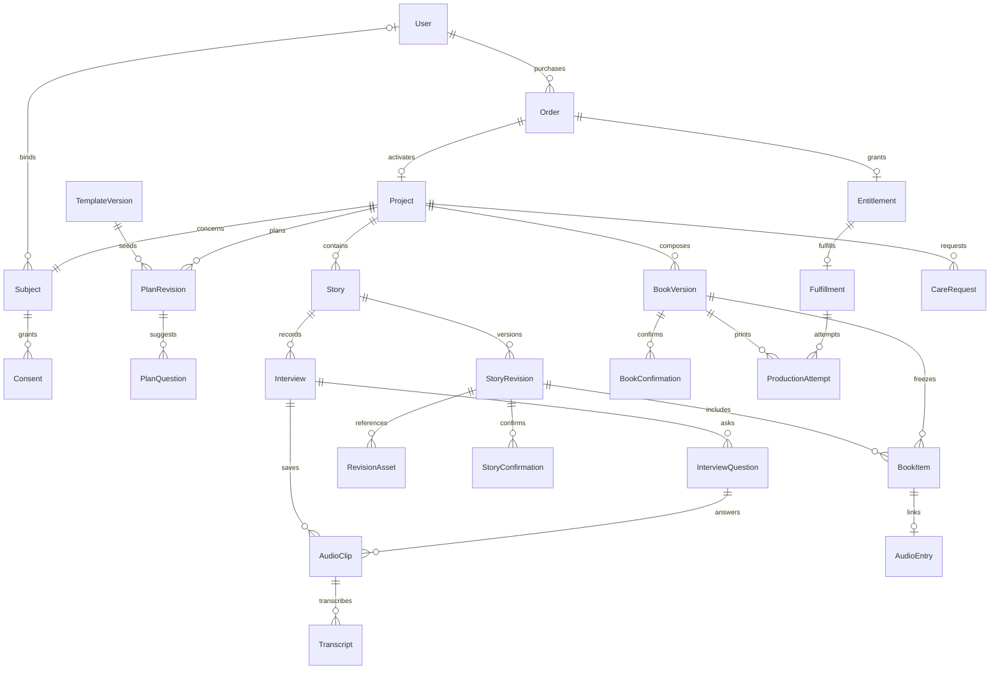

# 数据模型与不变量

版本：V1.0 · 2026年10月20日 · 定稿。本文定义[技术架构](技术架构.md)的数据契约，实施时据此建立迁移与约束；产品语义以[业务术语](../../GLOSSARY.md)和[MVP PRD](../时光里_岁月成书_MVP_PRD.md)为准。

数据库使用阿里云RDS PostgreSQL，通过Prisma访问；对象使用私有OSS。数据库大版本、云资源及连接参数在开通时冻结。

## 1. 三个必须分开的概念

1. **登录账号、讲述者、操作人**：微信账号标识实际操作者；讲述者是项目主人公，可以没有账号；同机操作记录发起人账号与讲述者同意，不能伪造为讲述者登录。
2. **原始素材、故事版本、书稿版本**：素材封存后不覆盖；编辑产生新故事版本；选定故事、封面和排版参数形成书稿快照。确认指向具体版本，不能只存 `confirmed=true`。
3. **支付、首本权益、生产单**：一笔已核验支付授予一份权益，生产提交预留权益，投产消费权益。退款或取消的处理不等于删除个人资料。

## 2. 核心关系

图中省略会话、文件、任务和审计。一个发起人可购买多个项目；同一位已绑定讲述者账号可以参与多个独立项目，但一个项目始终只有一个主人公。首版不做跨项目素材复用或自动合并同名讲述者。

## 3. 数据实体

所有业务记录使用服务端生成的不可猜测 ID；外部供应商 ID 单独保存。金额为人民币分整数，999元为 `99900`。时间存 UTC，展示按用户时区；书稿中业务日期使用明确格式。可变聚合保存整数 `version` 做并发控制。

### 3.1 身份与授权

| 表                       | 关键字段                                                                                                                                                   | 约束与用途                                                                                      |
| ------------------------ | ---------------------------------------------------------------------------------------------------------------------------------------------------------- | ----------------------------------------------------------------------------------------------- |
| `users`                  | id、status                                                                                                                                                 | 产品登录账号，不是家庭账户                                                                      |
| `wechat_identities`      | user_id、app_id、open_id                                                                                                                                   | `(app_id, open_id)`唯一；union_id仅在合法取得且确有需求时使用                                   |
| `sessions`               | user_id、token_hash、expires_at、revoked_at                                                                                                                | 可撤销的不透明会话；不把微信 session_key 给客户端或写日志                                       |
| `projects`               | order_id、buyer_user_id、title、recipient_type_id可空、relationship_label、current_plan_revision_id、phase、version、access_epoch、current_book_version_id | order_id唯一；access_epoch在撤回、绑定调整和删除时递增                                          |
| `recipient_types`        | code、label、enabled、sort_order、recommended_template_ids                                                                                                 | code唯一且稳定；运营发布/停用，停用不删除订单快照；自定义称呼不自动创建全局类型                 |
| `subjects`               | project_id、display_name、full_name可空、bound_user_id可空、binding_version                                                                                | project_id唯一；称呼来自项目关系文案/自定义称呼，姓名可后补；不默认索要身份证、手机号或完整生日 |
| `invitations`            | project_id、token_hash、expires_at、consumed_at                                                                                                            | 一个有效邀请；转发不能直接授予内容访问                                                          |
| `binding_requests`       | invitation_id、applicant_user_id、state、approved_by                                                                                                       | 讲述者申请、发起人确认；事务内绑定并使邀请失效                                                  |
| `consent_records`        | subject_id、scope、grantee_user_id可空、purpose、notice_version、method、operator_user_id、evidence_ref、granted_at、revoked_at                            | 按采集/AI处理、向发起人共享、协助操作、资料导出等目的记录；不以一个总开关代替全部权限           |
| `assisted_sessions`      | subject_id、operator_user_id、consent_record_id、started_at、ended_at                                                                                      | 限定一次同机协助；后续本人确认仍逐次留证                                                        |
| `operator_access_grants` | admin_id、project_id、care_request_id、scope、expires_at、revoked_at                                                                                       | 授权运营查看必要内容；审计元数据和查看私人正文是不同权限                                        |

`method` 至少区分本人微信确认、同机本人确认、客服核验。证据形式与核验程序为 D08 待定项；不声称点击记录等同于可靠身份验证。未完成独立绑定的申请人不能读取故事；不能将发起人自己的账号再次绑定为讲述者账号来绕过同机证据。

### 3.2 交易与权益

| 表                      | 关键字段                                                                                                                                                                       | 约束与用途                                                                                                         |
| ----------------------- | ------------------------------------------------------------------------------------------------------------------------------------------------------------------------------ | ------------------------------------------------------------------------------------------------------------------ |
| `package_versions`      | price_fen、spec、quotas、service_terms、refund_policy、published_at                                                                                                            | 不可变的已发布销售参数；必要参数缺失时不可售                                                                       |
| `orders`                | buyer_user_id、recipient_type_id可空、recipient_snapshot、initial_template_version_id、package_version_id、package_snapshot、out_trade_no、amount_fen、currency、payment_state | 商户单号唯一；关系code/称呼为购买快照，不用mother/father封闭枚举；固定默认中性模板；冻结价格、配送、期限和退款条款 |
| `payment_transactions`  | order_id、provider_transaction_id、verified_amount、verified_at                                                                                                                | 供应商交易号唯一；支付结果来自后端核验                                                                             |
| `refunds`               | order_id、out_refund_no、amount_fen、state、reason、entitlement_effect                                                                                                         | 退款单号唯一；支持公示规则中的部分退款，不假设只有全额退款                                                         |
| `entitlements`          | order_id、project_id、state、reserved_fulfillment_id、consumed_at、policy_version                                                                                              | order_id、project_id分别唯一；一本首本权益                                                                         |
| `project_service_terms` | project_id、package_version_id、activated_at、creation_expires_at、audio_access_expires_at、export_request_expires_at、retention_until、deletion_due_at                        | project_id唯一；按销售快照与实际起算事件计算，制作、访问、导出及保存期限独立，不把退款/制作到期直接当成删除        |
| `usage_entries`         | project_id、kind、business_key、reserved、consumed、released                                                                                                                   | `(project_id, kind, business_key)`唯一；用户额度与供应商实际计费分账                                               |

核验付款后按订单关系快照，在同一事务中建立项目、主人公、订单固定模板的初始项目计划及首本权益。称呼可自定义，缺失时使用“讲述者”，通用书名为“我的时光手记”，`full_name`可空；资料修改不阻挡邀请。后续修改关系称呼不更换主人公、不改变金额或重新发放权益。模板停用仍可读取已售快照；未通过内容审校的模板不可作为下单默认。

退款可用金额 = 已支付金额 − 已成功退款 − 退款处理中预留金额。锁住订单后预留，保证并发请求不超退。失败/关闭的退款释放预留，未知结果保持预留并查单。

额度采用同事务预留与结算：上传前预留许可的资源量，封存后按校验出的实际时长/体积结算，过期失败释放；生成任务按业务意图预留一次。并发申请须锁定项目的配额聚合，不能先读剩余额度再各自写入。期限与额度的具体数值由D02–D04确定。

### 3.3 采访计划与问题

| 表                                                | 关键字段                                                                                                                                                       | 约束与用途                                                                                   |
| ------------------------------------------------- | -------------------------------------------------------------------------------------------------------------------------------------------------------------- | -------------------------------------------------------------------------------------------- |
| `outline_templates` / `outline_template_versions` | template_id、version_no、locale、chapters、question_definitions、published_at、content_hash                                                                    | 发布版本不可变；停用不删除历史，内置题来源及审校留记录                                       |
| `plan_revisions`                                  | project_id、revision_no、base_revision_id、source_template_version_id可空、chapter_manifest、created_by、content_hash                                          | `(project_id, revision_no)`唯一；实际章节和顺序；复制模板后独立编辑                          |
| `plan_questions`                                  | project_id、plan_revision_id、question_key、chapter_key、text、intent、position、origin、enabled                                                               | `(plan_revision_id, question_key)`唯一；question_key跨计划版本保持问题身份，文本为不可变快照 |
| `question_progress`                               | project_id、question_key、state、last_interview_question_id可空、version                                                                                       | 区分未回答/稍后/已回答/跳过/不适用；换模板不重置本人选择，不要求全部答完                     |
| `interview_preferences`                           | project_id、version、blocked_topics、volunteered_context、updated_by、subject_evidence_ref可空                                                                 | 禁问以本人选择为准；仅讲述者/核验协助可重新启用，不从关系类型推断经历                        |
| `interview_questions`                             | project_id、interview_id、sequence、plan_revision_id可空、question_key可空、parent_question_id可空、text_snapshot、intent、origin、source_refs、response_state | 保存实际呈现问法；模板/自拟/模型/照片/自由讲述来源；历史不受计划改名影响                     |

计划编辑检查expectedVersion并生成包含章节和问题的原子版本；记录作者与授权。章节/问题撤下不级联删除素材。实际入书目录由book_versions冻结，项目大纲不能直接当可变书稿目录。

### 3.4 素材、文件转写与故事

| 表                    | 关键字段                                                                                                                                                        | 约束与用途                                                                           |
| --------------------- | --------------------------------------------------------------------------------------------------------------------------------------------------------------- | ------------------------------------------------------------------------------------ |
| `media_assets`        | project_id、kind、storage_provider=oss、bucket、region、storage_key、object_version可空、sha256、size、mime、duration、state、parent_asset_id可空               | 服务端校验后的最终文件；key唯一，客户端不可覆盖；父级关系追踪转码/缩略图等衍生物     |
| `upload_sessions`     | project_id、story_id、client_upload_id、staging_key、expected_size、state、expires_at、asset_id                                                                 | `(project_id, client_upload_id)`唯一；暂存上传与封存成功分开                         |
| `stories`             | project_id、current_revision_id可空、version、removed_at                                                                                                        | 故事稳定身份；已确认状态由当前版本的有效确认派生                                     |
| `interviews`          | project_id、story_id、starter_type、question_snapshot、photo_asset_id可空、active_question_id可空、state                                                        | question_snapshot仅为讲述起点，追问在interview_questions；允许继续补录               |
| `audio_clips`         | project_id、story_id、interview_id、interview_question_id、asset_id、client_clip_id、selected_transcript_id可空、sequence、speaker_subject_id、operator_user_id | `(project_id, client_clip_id)`唯一；保留讲述者、操作人、实际问题和录制顺序           |
| `transcripts`         | project_id、clip_id、attempt_id、raw_text、timed_segments、provider、model、source_audio_hash、completed_at                                                     | 仅来自已封存文件识别；同片段转写结果按尝试留版本，纠错稿另存；重转写不覆盖已确认故事 |
| `story_revisions`     | project_id、story_id、revision_no、title、paragraphs、theme、source_manifest、content_hash、origin、base_revision_id                                            | `(story_id, revision_no)`唯一；origin为AI/发起人/讲述者补录/经授权运营校对           |
| `revision_assets`     | project_id、revision_id、asset_id、kind、sequence、caption                                                                                                      | 固定照片、说明和音频顺序；照片增删、裁切、说明变化产生新版本                         |
| `review_items`        | project_id、revision_id、source_ref、question、state、resolution                                                                                                | 模糊/矛盾事实提示；未解决的阻断项不得确认入书                                        |
| `story_confirmations` | project_id、revision_id、subject_id、operator_user_id、method、evidence_ref、allow_in_book、confirmed_at、revoked_at                                            | 确认事实与入书许可分别记录；旧确认保留证据但不自动作用于新稿                         |

`source_manifest` 固定有序片段 ID、各自的转录 ID、照片及说明来源。长篇正文仍保留完整段落；全文必须参与排版。JSON用于冻结清单，核心关联同时落外键，不能只靠JSON字符串保证跨项目隔离。

文件转写使用business_tasks/task_attempts。音频封存事务同时写入逻辑转写任务与Outbox，按片段、资产hash、引擎配置及明确重转写意图去重。豆包任务保存供应商请求UUID、服务资源、模型/API配置版本、提交状态和时间；供应商标识不作为全局业务ID。正式转录成功后关联selected_transcript_id；整理稿固定全部选定转录ID，不读取运行中结果。失败保留原声，撤回后的迟到结果不能激活。

### 3.5 书稿、生产与资料

| 表                    | 关键字段                                                                                                                                                                           | 约束与用途                                                                           |
| --------------------- | ---------------------------------------------------------------------------------------------------------------------------------------------------------------------------------- | ------------------------------------------------------------------------------------ |
| `book_versions`       | project_id、version_no、snapshot_hash、plan_revision_id、cover_snapshot、chapter_snapshot、spec_version、template_version、render_build、pdf_asset_id、pdf_hash、page_count、state | `(project_id, version_no)`唯一；冻结实际章节、封面、故事顺序、照片、二维码和渲染环境 |
| `book_items`          | project_id、book_version_id、story_revision_id、sequence、chapter、audio_manifest                                                                                                  | 精确关联该版本的故事、照片与原声；书稿不通过“当前故事”动态取内容                     |
| `book_confirmations`  | project_id、book_version_id、role、subject_id可空、operator_user_id、snapshot_hash、pdf_hash、address_hash可空、method、evidence_ref、revoked_at                                   | 讲述者确认内容，发起人确认排版/地址；同机仍记录讲述者主体与发起人操作人              |
| `audio_entries`       | project_id、book_item_id、opaque_token、state                                                                                                                                      | token唯一且随机，生命周期不短于对应服务期限；稳定入口不存永久音频地址                |
| `fulfillments`        | project_id、entitlement_id、state、current_attempt_id、version                                                                                                                     | entitlement_id唯一；首本始终同一业务生产单                                           |
| `production_attempts` | project_id、fulfillment_id、book_version_id、pdf_hash、address_snapshot、state、reason、supplier_reference、handoff_at、ack_at                                                     | 首次/撤销后重提/质量返工分别留尝试；同一时刻至多一个活动尝试                         |
| `shipments`           | fulfillment_id、attempt_id、carrier、tracking_no、shipped_at、delivered_at、evidence_ref                                                                                           | 手工登记；交付时间依据签收核验或用户确认，不按发货天数推断                           |
| `care_requests`       | project_id、requester、type、verified_identity、scope、state、deadline、reason                                                                                                     | 退款、导出、更正、删除、撤回和质量售后的处理入口                                     |
| `export_packages`     | request_id、manifest、artifact_id、recipient_user_id可空、delivery_method、expires_at、state                                                                                       | 默认只允许核验的申请人获取；无微信讲述者的替代交付方式须另行核验，不默认交给发起人   |
| `deletion_items`      | request_id、resource_type、resource_id、state、provider_receipt、due_at                                                                                                            | 覆盖素材、转录、稿件、PDF、导出包、衍生图与供应商副本                                |

配送地址在发起人确认时冻结，后台不能原地修改已投产地址。改地址仅使对应发起人确认失效；内容/封面/PDF改变则双方均重新确认。已生产版本保留“曾经生产”的历史事实，但个人内容仍受删除政策控制。

### 3.6 工程能力

| 表                    | 关键字段与规则                                                                                                                                                              |
| --------------------- | --------------------------------------------------------------------------------------------------------------------------------------------------------------------------- |
| `business_tasks`      | project_id、kind、input_manifest、input_hash、base_revision_id、access_epoch、state、deadline、lease_until、fence_token；逻辑意图唯一                                       |
| `task_attempts`       | task_id、attempt_no、provider、provider_request_id、provider_task_id可空、provider_config_version、submitted_at、status、cost_usage、error_code；供应商任务号不作为全局主键 |
| `outbox_events`       | event_id、task_id、type、published_at、attempts；与业务任务同事务创建，可重复投递                                                                                           |
| `webhook_inbox`       | provider、event_id、payload_hash、verified_at、processed_at；唯一去重，敏感原文加密并按期限清理                                                                             |
| `idempotency_records` | actor、operation、resource_scope、key、request_hash、result_ref、status；同键异载荷冲突，持久业务唯一约束不依赖缓存存活                                                     |
| `audit_events`        | actor、subject、project、action、resource_version、reason、request_id、created_at；追加记录，不抄录私人正文、令牌或完整地址                                                 |

## 4. 数据库必须保证的约束

| 不变量                          | 实现约束                                                                                                                               |
| ------------------------------- | -------------------------------------------------------------------------------------------------------------------------------------- |
| 一次付款不重复发权益和项目      | `orders.out_trade_no`、`payment_transactions.provider_transaction_id`、`projects.order_id`、`entitlements.order_id`唯一；发放同一事务  |
| 同一权益只有一个首本生产单      | `fulfillments.entitlement_id`唯一；重印在原单下新增生产尝试                                                                            |
| 素材/故事/版本不串项目          | 关联表保存project_id，并以复合外键引用`(project_id, id)`；当前版本还须属于对应story，book item须属于对应book version，不能仅验证同项目 |
| 一个项目一位讲述者              | `subjects.project_id`唯一；绑定申请审批锁住项目和主体                                                                                  |
| 重复上传不产生多个片段          | `(project_id, client_clip_id)`唯一，已封存对象校验值固定                                                                               |
| 模板更新不覆盖个人计划          | 模板和计划按版本追加；项目固定具体版本；问题及章节按project_id隔离                                                                     |
| 正式转录不漏片段或重复生效      | 固定封存资产/hash、任务输入和租约；结果按任务幂等；选用转录在片段锁内条件更新，替代结果不自动重写已确认来源                            |
| 更新不覆盖别人的改稿            | `WHERE id = ? AND version = expected_version`条件更新，冲突返回409                                                                     |
| 两个并发确认/印刷请求不越过撤回 | 共享项目锁；确认检查版本、授权epoch和删除状态；撤回更新相同聚合                                                                        |
| 同一生产单没有两个并行交接      | 活动生产尝试的部分唯一索引或等效条件约束                                                                                               |
| 退款不超额                      | 金额正数检查 + 订单行锁 + 退款预留，成功金额和处理中金额一起计算                                                                       |

PostgreSQL 的唯一约束、外键和行锁支持上述保护；跨行金额汇总和业务状态不能只靠 `CHECK`，必须在事务中验证。[Constraints](https://www.postgresql.org/docs/current/ddl-constraints.html)、[Explicit Locking](https://www.postgresql.org/docs/current/explicit-locking.html)

统一锁顺序为订单（若涉及交易）→ 项目 → 权益 → 书稿/生产单 → 子记录。调用方按需取锁并遵循顺序；短事务内不调用支付、ASR、模型或对象存储网络接口。死锁/序列化失败仅对无外部副作用事务做有限重试。

## 5. 状态的所有权与前端映射

| 对象     | 内部状态/阶段                                                                                                                  | 对用户的表达                                              |
| -------- | ------------------------------------------------------------------------------------------------------------------------------ | --------------------------------------------------------- |
| 上传     | local_pending → uploading → verifying → sealed；失败可重试                                                                     | 待上传 / 保存中 / 云端已保存 / 保存失败                   |
| 任务     | queued → running → waiting_provider → succeeded；retry_wait / failed / cancelled / obsolete                                    | 转写中 / 整理中 / 失败及下一步；旧任务不覆盖当前稿        |
| 故事     | 当前版本无有效确认 / 有本人确认 / 获准入书 / removed                                                                           | 待本人确认 / 已确认；是否入书单独展示                     |
| 书稿     | building → ready → jointly_confirmed；invalidated / failed / revoked                                                           | 生成中 / 待确认 / 已确认 / 确认失效                       |
| 首本权益 | available → reserved → consumed；suspended / revoked                                                                           | 不直接给讲述者展示复杂状态，返回可执行动作                |
| 生产尝试 | awaiting_review → approved → handoff_pending → in_production → shipped → delivered；on_hold / cancellation_pending / cancelled | 待生产审核 / 生产中 / 已发货 / 已交付；交接待核实明确提示 |
| 退款     | requested → approved → processing → succeeded；rejected / failed / closed                                                      | 申请中 / 处理中 / 已退款 / 需客服处理，显示实际金额       |

`orders.payment_state`保留待付款/已付款/已关闭事实；退款状态和已退金额独立派生，支持部分退款。项目阶段由参与、故事、书稿和生产事实派生并可缓存；任务失败不把项目标成终止，退款不自动清空内容，期限到期不等于删除。

## 6. 不可变与删除如何兼容

“不可变”约束正常编辑和生产追溯，不等于永久保存个人信息。删除执行时移除内容载荷、对象和衍生包，版本可保留不含正文的最少状态/审计墓碑，财务记录按适用要求单独保留。内容校验值也按敏感元数据控制访问，不建立公开指纹库。

备份、对象历史版本、渲染临时目录、运营导出与供应商副本均进入清理清单；是否完成删除须区分在线访问已停止、活动数据已清除、备份已到期以及外部副本已处理。具体保存期限见 [决策与待定项](决策与待定项.md)。
