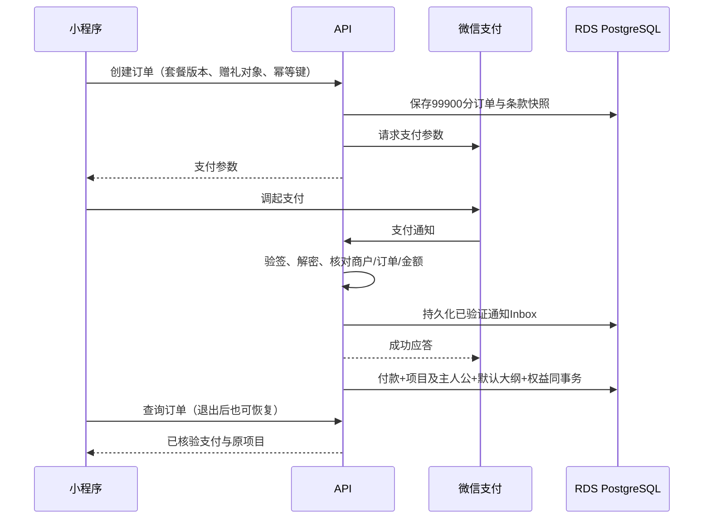
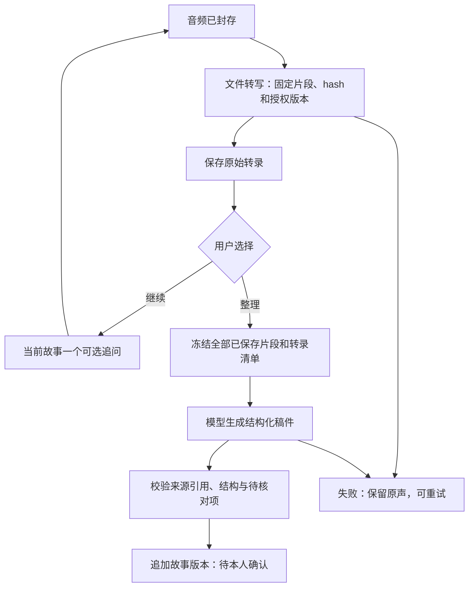

# 关键流程与接口契约

> 2026-10-22 当前范围：后端单套固定模板与可编辑个人计划（[ADR 0008](../adr/0008-single-builtin-template.md)）；固定首版政策、探针复用及受控人工运营（[ADR 0010](../adr/0010-mvp-fixed-policy-and-reuse.md)）。正文已按当前范围修订，历史方案见 Git 记录。

版本：V1.0 · 2026年10月20日 · 定稿。配合[技术架构](技术架构.md)及[数据模型](数据模型.md)阅读。本文定义流程和接口契约，服务端实现后生成OpenAPI并执行契约验证。

## 1. 通用接口约定

- 内部用户接口 `/v1`、运营接口 `/v1/admin`、供应商通知 `/v1/webhooks`；独立域名 `https://timenookapi.threeminreading.com` 下公网在内部路径前加 `/api`，代理只剥离该前缀一次。完整映射以 [ADR 0015](../adr/0015-dedicated-domain-ingress.md) 为准。管理员和用户会话隔离；供应商通知使用对应验签规则，不复用用户身份。
- 后端对齐wutong-admin的NestJS/Fastify及DTO校验/OpenAPI组织；云数据使用RDS PostgreSQL，文件使用私有OSS。
- 小程序用微信登录凭据换取服务端可撤销会话；后端自行验证微信返回身份，不相信客户端传入的 openid。管理端采用独立账号、MFA、HttpOnly/Secure会话和CSRF保护。
- 成功响应 `{ data, meta: { requestId } }`；错误 `{ error: { code, message, retryable }, meta: { requestId } }`。业务状态使用枚举，不让客户端解析提示语。
- 异步命令返回202和 `taskId`，任务查询返回 `state / phase / errorCode / retryable / nextAction`；不把请求受理等同于内容生成成功。
- 创建订单、封存上传、生成稿件、确认、首本提交、退款等命令携带 `Idempotency-Key`。服务端以操作者+动作+资源范围+key去重；同键同载荷返回原结果，同键异载荷返回409 `IDEMPOTENCY_CONFLICT`。
- 更新/确认携带 `expectedVersion`；版本变化返回409 `VERSION_CONFLICT`，客户端刷新并展示新稿后再确认。幂等重放也需检查当前权限，撤回后不回传旧的敏感结果。
- 返回401会话失效、403已知资源无操作权限、404不存在或应隐藏的资源、409状态/版本冲突、422输入不满足业务条件、429限流。未知扫码者统一收到不含私密标题的响应。
- `requestId`仅用于排障；敏感字段不进入日志。资源ID不能代替鉴权，所有关联查询必须限定项目与资源归属。

## 2. 购买、付款恢复与退款

通知成功应答的前提是验证通过并已持久化；后续处理失败由Inbox扫描恢复，不能只放进内存或Redis就应答。支付回调与主动查单使用同一 `applyVerifiedPayment` 用例，核对商户号、应用、币种、金额、商户订单号和交易状态。前端 `requestPayment` 成功回调只触发查询，不授予权益。

创建订单携带 `recipient: { typeCode?, relationshipLabel }`；typeCode来自启用类型，自定义称呼不自动写全局类型库。服务端校验长度、冻结关系快照与初始中性模板版本，参与幂等载荷比较；关系类型不改变同一套餐的价格。核验付款后同事务激活默认称呼、书名、项目计划及权益，不要求客户端再建项目。类型后续停用不阻止已售订单恢复；退出重进仍返回原项目。修改称呼不替换主人公。

候选采用普通商户小程序JSAPI下单；商户主体与AppID绑定、商品准入、iOS/Android及交易类小程序发货管理须先核验，选择服务商时另换对应配置。通知可能重复且不能依赖必达，故需Inbox去重、数据锁与查单。[接入准备](https://pay.wechatpay.cn/doc/v3/merchant/4015459512)、[支付通知](https://pay.wechatpay.cn/doc/v3/merchant/4012791902)

补偿机制：对待付款但客户端报告完成的订单、长时间未终态通知和对账异常主动查单。关闭订单也需核对微信状态；出现关单与成功支付竞态时保留真实支付事实，进入恢复权益或人工退款处理，不能当作未付款丢弃。

退款由客服建单并核验已公示规则，后端锁订单预留可退金额，固定 `out_refund_no` 后调用供应商。超时先查询该退款单，不另换单号重复退款。成功通知验签、解密并校验本地金额及订单后入账。[微信支付退款通知](https://pay.wechatpay.cn/doc/v3/merchant/4012791906)

批准退款时冻结新投产，`entitlement_effect`由退款原因和政策确定：全额终止、部分退费保留权益、质量赔付等不能一律撤销权益。若供应商已交接或状态未知，先走人工核验，不自动释放首本权益。任何退款均不静默删除讲述者资料。

### 服务期限的执行归属

T05 冻结 D02/D03，T08/T10 固定销售快照。T10 负责项目期限计算与幂等事件处理：只按首版冻结政策需要的付款、本人参与、制作到期或交付事实建立独立期限；尚未发生的事件保持未起算。T11/T12 提供本人参与事件，T23 提供交付事件；暂停/恢复及未开始处理按冻结 D02 执行，重放事件、换绑或修改套餐不延长旧项目期限。

T14 执行新录音的制作期限条件，T22/T23 执行首本提交与交接时的到期规则；T21 检查回听期限，T25 分别检查导出申请期与包下载期，T26 执行保留到期与删除期限，T29 验证调度及停机补偿。制作到期和退款不直接删除资料。期限测试覆盖到期前、恰好到期、到期后、暂停上限、重放及重启；真实参数未冻结时只验证隔离合成规则。

## 3. 讲述者绑定与同机协助

邀请采用服务端生成的随机令牌，库中保存摘要和有效期。未授权页面仅展示参与说明及必要的发起人提示，不展示私人标题、故事、照片或原声。

1. 讲述者打开邀请并登录，阅读告知后申请绑定；此时没有私人内容访问权。
2. 发起人确认申请人身份；事务锁项目和主人公，确认仍未绑定、邀请有效，再完成绑定并作废邀请。
3. 讲述者就采集、AI处理及向发起人共享分别作出明确选择；拒绝时项目保留订单和客服入口，不进入采集。
4. 更换绑定由 T11 实现客服核验流程：在原 subject 不变的前提下记录工单、操作者和 D08 本人证据，原子更新绑定版本与 `access_epoch`；旧账号的本项目权限及旧幂等结果访问立即失效。新账号须重新完成适用授权，历史确认保留原主体/操作人与版本。并发换绑只能有一个有效结果，不能用换绑替换讲述者，也不撤销旧账号在其他独立项目的合法身份。

同机模式不创建假的讲述者微信账号：记录 `subject_id=讲述者`、`operator_user_id=发起人`、`method=assisted`、告知版本及当次同意证据。协助录音与本人确认是不同动作；讲述者阅读或听读后逐次确认指定故事/书稿版本。服务端不能仅根据付款身份推定讲述者同意。

这是可追溯的协助机制，不具备独立识别设备前真实发言人的能力。首批可接受的证据方式、争议核验和无微信讲述者的资料交付通道，必须在 D08 决策中落实后上线。

## 4. 录音、照片与可靠保存

### 4.1 客户端生命周期

小程序使用`RecorderManager`录成文件，停止后持久化真实本地路径与上传清单；以16kHz、单声道、48kbps MP3为采集验证起点。初始产品段长建议1–5分钟，麦克风/平台隐私与业务同意、格式/时长、存储空间、来电/后台/锁屏/强杀行为由iOS/Android真机验证。录音过程仅计时；处理链从已保存文件开始。[录音参数](https://developers.weixin.qq.com/miniprogram/dev/api/media/recorder/RecorderManager.start.html)

单故事的录音顺序如下：

1. 创建采访和稳定 `client_clip_id`，录音结束保留实际文件及长度；本地保存失败明确提示。
2. 创建上传会话，获得只允许当前暂存对象写入的短期凭证。配额、扩展名、字节上限和项目范围由服务端限定。
3. 小程序使用API返回的PostObject V4 policy/签名表单和wx.uploadFile直传OSS私有暂存区；调用完成接口。客户端HTTP成功不等于云端已保存。
4. 服务端检查对象真实存在、大小、类型、音频可解码、时长及校验值；封存为只有服务端可写的最终对象。
5. 同事务记录最终对象、录音片段及顺序，结算额度并创建文件转写任务/Outbox；成功后返回sealed，此时页面才显示“云端已保存”，可清理不再需要的本地副本。

暂存区不能成为原声的长期路径：上传凭证未过期时同名对象可能再次被写入。优先固定对象版本后复制；若存储不提供可固定版本，服务端把收到的字节流复制至新随机最终key并重新校验最终文件。只有最终文件验证成功才封存；客户端永远不能覆盖最终前缀。

数据库和对象存储不在同一事务：复制成功而落库失败产生孤儿对象，扫描器延后清理；落库只在最终对象已验证后进行。重复完成调用返回同一个资产和片段。若本地文件失去且云端未封存，明确告知不可恢复的部分，不虚报成功。

来电、暂停、退出和恢复事件交由单独录音控制器管理；只能承诺已经封存成功的音频不因客户端退出丢失。不能依赖系统总会触发结束回调。正在录制但未保存的片段须清楚标注风险，保留能够恢复的实际文件。

### 4.2 保存后的异步转写与等待

每段封存后建立`kind=transcribe_audio`的RDS数据库任务，输入固定clip ID、asset/hash、格式、豆包服务资源与模型/API配置版本和access_epoch；同一次封存只创建同一逻辑任务。Worker在调用前持久化供应商请求UUID与提交状态，再向豆包提交限时文件源URL；调度器用同一请求UUID查询，避免HTTP或Worker空等。成功结果在租约/fence和授权复验后保存原始转录。

页面可见时用HTTPS轮询任务，建议2秒起退避至10秒；切后台停止轮询、返回立即刷新。用户可离开、回听、继续补录或提交整理；任务状态从服务端恢复，不能因前端退出取消已受理处理。转写/整理重试复用已封存音频及原业务意图，不重复扣用户额度；外部未知结果先查原任务，实际供应商重试费用另记。

追问只在所需文件转写完成后发起，固定实际问题、当前故事转录与偏好版本。尚未完成时允许按原问题继续说、换题或完成；完成整理任务会等待全部已选片段转写。用户换题、补录改变输入、结束或撤回后，旧追问结果作废。没有可识别语音时给回听/补录/换题选择，不生成无来源故事。

### 4.3 照片

照片同样走暂存/校验/封存流程，校验真实格式、尺寸和大小。原图私有保存；展示/印刷衍生图去掉不必要的定位等元数据并记录与原图关系。旋转、裁切或文字说明变化形成新故事版本。照片起讲关联到当前采访，事后补照片无需重转写已有音频，但入书内容变化须重新确认。

选择图片使用`wx.chooseMedia`，原图、预览图和印刷图分别记录；必要压缩不覆盖唯一高清来源。服务端限制像素/解码资源，应用方位并校验HEIC等格式转换能力；照片清晰度按实际印刷尺寸判断。图片逐文件重试、封存幂等；STS只允许指定暂存对象，最终对象客户端不可写。图片缩略图也携带会话经授权网关下载到临时路径再交图片组件，限制下载并发/缓存并在撤回后清理，不能用公共目录或假设image的src支持自定义鉴权头。

## 5. 任务链、AI质量与恢复

每片段封存后自动开始文件转写；用户点击整理才冻结全部素材。未完成转写仍是任务依赖，不能漏掉后半段录音。追问仅在停录、封存与正式转录就绪后执行，使用当前故事转录、实际问题目的、问题历史和本人偏好。规则先排除禁问/不适用/重复，再选人工候选或请求模型一条短问题，失败可跳过；等待期间可继续讲述或完成；过期追问不替换新问题。

### 5.1 项目大纲与问题计划

后端固定模板版本只读，审校后随代码发布；项目复制后独立编辑。计划更新携带expectedVersion，将章节和问题作为一次原子新版本写入；删章节不删除原声，已有故事移到待归类或用户指定章节。个人编辑保留已回答关联与禁问选择，不强制答完；代码模板升级不迁移旧计划。实际提问快照记录当时文本、问题目的、来源、计划版本和对应录音，用户改写追问后保存实际问法。

两角色经权限检查可编辑计划；讲述者或核验协助流程决定拒答、禁问及重新启用。普通跳过、稍后和不适用分开，不能被发起人编辑计划静默复位。只改未来问题不重转写或撤销已有内容确认；改变实际目录使待生产书稿失效；改故事内容则生成新故事版本。详见[大纲与追问设计](大纲与追问设计.md)。

模型输出契约为 `title / paragraphs[{text, sourceRefs}] / theme / reviewItems[]`。sourceRefs指向当前清单的转录片段或用户校对说明；结构校验拒绝未知引用、无效JSON和缺失段落。保留模糊时间、冲突事实和“未知”，不由模型补造精确事实。

来源引用和规则检查只能降低风险，不能证明生成文字逐句真实。上线评测人工对照原声，记录无来源人物、时间、地点、对白和观点；必要核对项未解决时阻止确认。正文显示AI整理及人工校对来源，模型输出始终待本人确认。

### 5.2 可靠执行协议

1. API短事务内写业务任务、输入快照、用户额度预留和Outbox事件。
2. 投递器读取已提交Outbox并发布BullMQ，任务ID用作稳定jobId；投递后记录结果。投递后崩溃可重复发布，消费者仍须幂等。
3. Worker读取业务任务，核对状态、授权、输入版本和截止时间；原子领取租约并递增 `fence_token`。
4. 事务外调用供应商。已取得供应商任务号则持久化，异步查询时释放Worker，不让队列线程空等数分钟。初版ASR优先轮询；供应商回调后续再按独立验签接入。
5. 结果落库前再次核对任务租约/fence、授权epoch、删除状态和目标版本。旧Worker、已撤回项目或过期输入的结果不能激活为当前故事；迟到文件进入隔离清理。
6. 成功时同事务写结果、任务终态、用量与下一阶段Outbox；失败保存可读原因。用户重试不重复扣同一逻辑意图额度，供应商重试费用另行计入成本。

Outbox只解决“业务提交后需要投递”的恢复，不能保证外部ASR或模型只执行一次。供应商支持幂等键时使用；请求结果未知时先查原任务，不能查询或去重的供应商可能产生重复计费，必须设尝试次数与费用上限。业务结果靠唯一键与fence防止重复生效。

另设扫描器处理：未投递事件、已投递却无进展的任务、租约过期任务、失败待人工任务及无引用对象。即使Redis数据丢失，也能从数据库的非终态任务恢复投递。BullMQ任务可能因Worker失联而重新执行，因此不能把队列锁当作业务唯一性保证。[BullMQ stalled jobs](https://docs.bullmq.io/guide/workers/stalled-jobs)、[幂等任务建议](https://docs.bullmq.io/patterns/idempotent-jobs)

### 5.3 输入变化与处理目标

- 输入保存 `base_revision_id`、故事版本、素材清单hash及授权epoch。处理期间用户改稿或补充素材，旧结果标记 `obsolete`，不得覆盖新稿；可由用户明确选择再次整理。
- 平台性错误（网络、429、5xx）指数退避并加随机抖动，初始建议最多3次且不超业务截止时间；权限撤回、输入非法、确定的配额拒绝不自动重试。
- 对不超过5分钟的输入，按PRD以“用户提交整理且输入均已云端保存”到“成功出稿”计时，内部试点目标95%在3分钟内成功出稿；队列等待和依赖转写包含在内，须按豆包转写与DeepSeek整理的端到端实测校准。
- 180秒目标不得靠大批主动失败达标：同时统计成功率、人工接管率和端到端耗时。超过页面等待预算但供应商未终态时继续显示处理中/可离开，不伪写失败或重新提交；真正超过配置业务截止时间才按失败/人工处理，迟到结果不悄悄覆盖已结束意图。

豆包标准版文件识别采用异步提交/查询。适配器按选定API版本映射受理、处理中、成功、无有效语音及失败，HTTP成功不等于转写成功。请求UUID关联自有任务、服务资源、配置版本和提交时间；外部提交结果未知时先查询同一请求，确认状态后受控恢复，不能盲目重复提交。私有OSS提供限时公网HTTPS源URL，保证供应商实际取源窗口及STS有效期，及时持久化结果；按实际跨云出网计费。[豆包文件识别接口](https://docs.volcengine.com/docs/DoubaoVoice/LargemodelrecordingfilerecognitionstandardversionAPI?lang=zh)

## 6. 故事确认、书稿与印刷

### 6.1 故事版本

编辑正文、照片说明、照片排序/裁切或补录后重新整理，都创建新 `story_revision`。事务内切换当前版本并让关联的待生产书稿失效；与该故事无关的历史稿不必重建。旧版本确认作为历史记录保留，不继承到新版本。

本人确认命令携带revision ID、内容hash、expectedVersion、入书选择及确认方式，服务端核验主体/操作人、授权和待核对项。同机确认记录讲述者为确认主体，发起人为操作人，证据与对应版本绑定。

已印刷的书稿不随在线编辑变更；后续更正由客服处理数字内容与售后。撤回入书许可或删除涉及的素材，应立即暂停相关尚可停止的生产，并停止相应数字访问。

### 6.2 生成确定书稿

Book用例一次冻结：项目大纲版本、实际入书章节与顺序、已确认且允许入书的故事版本、照片及说明、封面、书名、渲染模板和规格版本、原声清单、二维码入口。空章节/未答问题不生成虚构内容；不要求逐题完成。

渲染任务只读取该快照，不在渲染过程中查询“最新正文”。使用受控字体、字号和页边距；等待字体/图片加载，全文连续分页。章节页码与目录通过分页测量再生成，目录占页变化时迭代至页码稳定，未收敛则失败，不能给出错误目录。

T20 将适用的 AI 整理及人工校对来源标识写入制作说明和 PDF，标识随快照冻结、参与文件 hash 与逐页检查；真实原声及其入口不误标为合成音频。T25 继承同版标识到确认稿、PDF、清单与可读说明，具体适用方案由 D08 核验，未确定时保持待验收。

PDF生成后核验：正文无遗漏/截断、照片可用、页数符合规格、二维码可识别，保存PDF文件hash及渲染器版本。先预留二维码稳定入口，再渲染，避免预览后补码改变最终文件。小程序预览和投产读取同一个文件；如印厂要求颜色转换/出血/字体处理，处理后的最终文件也必须预览、确认并冻结hash。

书稿总览的书封、目录、内页节选、故事数和页数均来自同一有效书稿版本；节选只用于概览，完整PDF入口用于逐页校对。页数取实际渲染结果，不使用固定示例数值或完成百分比。每篇故事关联对应原声，不承诺整理后的文字与录音逐字一致。

Playwright提供打印媒体下的PDF生成能力；这不等于自动满足印厂的色彩、出血或PDF/X要求。正式规格须由供应商打样验证；不合格时替换渲染实现或增加受控印前步骤，沿用相同版本接口。[Playwright page.pdf](https://playwright.dev/docs/api/class-page#page-pdf)

### 6.3 双方确认和首本权益

讲述者确认入书内容与书稿版本，发起人确认完整PDF及地址。确认记录均包含 `book_version_id / snapshot_hash / pdf_hash`；发起人记录额外包含地址hash。少量故事允许预览，只有满足公示生产规格才能提交印刷，不能将约20篇变成强制条件。

`submitFirstCopy`使用统一锁顺序，在同一事务中验证：

1. 订单付款已核验，退款/撤回未冻结生产，首本权益可用。
2. 书稿为当前有效版本，所有所含故事版本仍有效确认且获准入书，素材未删除，授权未撤回。
3. 双方确认均匹配该PDF及内容hash，发起人地址确认仍有效，规格检查通过。
4. 预留权益并创建/恢复同一个首本生产单，创建待审核生产尝试，写审计和Outbox。

相同幂等键返回原单；不同键的并发请求也被权益唯一约束挡住。提交时没有第二次支付动作。生产审核再次检查相同条件，不允许只看“已提交”状态。

印刷确认页显示“已付999元 · 本次无需支付”、当前书名与书稿版本、制作1本及约定配送信息；校对和地址确认未满足时不能提交。制作时限以书稿锁定并审核后的公示起算规则为准，不从购买日推算成书日期。

### 6.4 人工交接的不可逆边界

审核通过后进入 `handoff_pending`，固定生产尝试、PDF hash、地址及供应商交接编号。操作员下载/交接前再验证；记录何时发送、何文件及供应商接收回执。供应商确认接单后进入 `in_production`并消费首本权益。

外部印厂无法与数据库原子提交：若文件已发出而系统/人员未记录接单，状态保持待核实，禁止生成新交接或释放权益。撤回发生在交接前可取消；交接中或以后进入 `cancellation_pending`并人工联系印厂确认，不承诺后台一个点击能取消已经印刷的实物。

确认取消后才能解锁或重新提交，原生产单保留新的尝试记录。质量重印同样挂在原单下，注明原因并指向确定书稿；重印若改了正文/排版，仍需新版本确认。系统不新增付费加印入口。

## 7. 原声二维码、访问与撤回

二维码只放随机稳定入口标识，不放姓名、项目ID、音频URL或访问凭证。拟使用小程序码直达原声页，scene参数容纳能力与正式版路由需实测；可用22字符随机标识作为候选，不先把平台限制当成已验证事实。

扫码 → 微信登录 → 服务端解析入口 → 校验资源存在、项目关系、讲述者共享授权、服务期限与删除状态 → 返回该书稿版本的有序录音列表。未知/未授权访问不返回标题、缩略图或音频元数据。

**用户播放和下载统一走鉴权文件网关。** 对象桶保持私有，浏览器/小程序不获得可转发的长期存储链接；每个Range/下载请求及续传重新检查会话、资源和授权epoch。首版量小，网关带宽代价可接受。内部网关可以获得短期签名源地址，但不将其重定向暴露给用户。

小程序短段音频首选“携带产品会话鉴权下载到临时文件，再交给原生播放器本地播放”，每次开始播放前刷新授权，播放结束/退出清理临时文件；PDF同样鉴权下载后交给原生预览。不要假设音频组件的`src`支持自定义Authorization请求头。下载请求头、临时路径播放和缓存清理均列入S0真机验证；首版不为方便播放器而把会话令牌放进公开URL。

讲述者撤回或删除时先提交拒绝访问状态并递增epoch；网关检查不使用过期的允许缓存，主动关闭相关活动流。新请求立即拒绝，已经传输至设备的字节或用户此前导出的文件无法远程收回。小程序清理受控缓存，说明纸书及已保存副本的边界。

AI供应商取音频所需的临时源地址属于另一受控通道，限定对象、目的及短有效期；在途任务撤回后不接受生成结果，并触发供应商删除/到期处理。不能声称签名URL天然绑定某个用户。[OSS临时授权](https://help.aliyun.com/zh/oss/developer-reference/use-temporary-access-credentials-provided-by-sts-to-access-oss)

## 8. 完整导出与删除

### 8.1 导出

首版由客服受理、核验身份与范围，运营通过内部打包命令/任务制作ZIP；不要求用户自助生成。包内包含：原声、原始转录、确认稿、照片、可交付PDF，以及 `manifest.json` 和可读说明。清单记录项目/故事/版本、文件相对路径、hash、来源与对应关系；导出格式无需本平台即可读取。

完成前检查缺失文件、ZIP可解压、文件数量与hash、非当前版本是否应包含以及申请范围。输出包再次检查当下授权，只交给核验的申请人，设置下载期限并记录交付。发起人无导出授权时不能取得讲述者资料；无微信讲述者由已确认的替代核验通道交付，不默认转发给付款发起人。到期清理包副本，个人资料保存期限另行计算。

运营统一采用[共享工单与人工边界](../delivery/2026-10-22/spec.md#人工运营边界)。核验/批准可人工完成，打包、清理、退款及权限动作仍使用受控工具或业务用例，用户申请与进度查询保留。

### 8.2 删除与撤回任务

T26 同时接收经核验的删除请求和 D03 保留期届满事件，使用同一清单与墓碑流程；按文件类别及副本层级冻结的规则计算期限。调度停机后补扫过期项目，事件重放不重复删除或复活资料；备份与供应商期限分别反馈，不以活动数据清理代替全部完成。

1. 核验申请人和范围；有效撤回先停访问、停止新采集/处理、冻结相关生产并递增epoch。
2. 生成删除清单：原声、转码、照片、缩略图、转录、故事、PDF、导出包、任务输出、临时目录和外部副本。
3. 取消排队任务；运行中任务在结果提交时再次检查墓碑，拒绝重建资料；后台清理迟到输出。
4. 删除活动对象及需要清除的历史对象版本、数据库内容和缓存；备份标记受删除约束并按公示期限轮换。
5. 运营确认供应商及临时下载副本处理；不能核实的副本标记待处理并告知实际进度。
6. 保留必要的最少请求/财务/审计记录；完成状态明确区分活动数据完成、备份待到期、外部副本待确认。

备份恢复必须先在隔离环境应用独立保存的删除/撤回台账，再开放业务流量，避免旧备份让已删除资料再次上线。保留期限及例外需在上线前公示；本文不代替适用法律和供应商合同审核。

## 9. 端点与权限清单

接口路径定义如下，ID均按项目归属校验。`P`为已授权讲述者，`B`为发起人，`O`为具备工单范围的运营；同机操作在有记录的协助流程内执行。

| 方法与路径（省略内部 /v1；独立域名下公网加 /api）                                  | 角色           | 输入/结果与关键限制                                                      |
| -------------------------------------------------------------- | -------------- | ------------------------------------------------------------------------ |
| `POST /sessions/wechat`                                        | 公开限流       | 登录code换产品会话；不返回session_key                                    |
| `GET /packages/current`                                        | 公开           | 已发布套餐、条款和支持地区；未完整配置不可售                             |
| `GET /recipient-types`、`GET /outline-templates`               | 公开/登录限流  | 当前启用类型和已发布模板摘要；不返回私密项目                             |
| `POST /orders`、`POST /orders/:id/payment`                     | B              | 含套餐版本与recipient关系快照，校验配送地区和幂等载荷；返回订单/支付参数 |
| `GET /orders/:id`                                              | B              | 真实支付、权益及项目；可触发受限查单                                     |
| `GET /projects`、`GET /projects/:id`                           | P/B            | 仅可访问项目，阶段和可执行动作                                           |
| `PATCH /projects/:id`                                          | B（或有权限P） | 可选修改称呼、姓名、书名及expectedVersion；使受影响书稿失效              |
| `POST /projects/:id/invitations`                               | B              | 返回邀请入口；不能读讲述者未授权内容                                     |
| `POST /invitations/:token/requests`                            | 登录申请人     | 只创建绑定申请，不授予阅读权                                             |
| `POST /binding-requests/:id/approve`                           | B              | 锁项目，确认绑定，作废邀请                                               |
| `POST /projects/:id/consents`、`POST /consents/:id/revoke`     | P/核验协助     | 同意范围、告知版本、方式与证据；撤回先停止访问                           |
| `POST /projects/:id/assisted-sessions`                         | B              | 讲述者在场的同意证据，返回协助会话                                       |
| `GET /projects/:id/plan`、`POST /projects/:id/plan-revisions`  | P/授权B        | 章节/问题编辑，expectedVersion；记录个人题与禁问保护       |
| `PATCH /projects/:id/question-progress/:key`                   | P/核验协助     | 跳过/稍后/不适用；不删除已录内容；禁问恢复只允许本人核验流程             |
| `GET /projects/:id/questions`、`POST /projects/:id/interviews` | P/协助B        | 计划问题/自拟/照片/自由讲述；冻结实际问题文本和目的                      |
| `POST /interviews/:id/uploads`、`POST /uploads/:id/complete`   | P/协助B        | clip或photo、客户端ID；受限上传和封存状态                                |
| `GET /interviews/:id`                                          | P/授权B        | 恢复已保存片段、未完成采访与处理状态                                     |
| `POST /interviews/:id/follow-up`                               | P/协助B        | 当前故事的一条追问任务，允许跳过                                         |
| `POST /stories/:id/drafts`、`GET /tasks/:id`                   | P/授权B        | 固定素材清单、baseVersion；返回任务及终态                                |
| `GET /stories/:id`、`POST /stories/:id/revisions`              | P/授权B        | 读取/校对当前稿；新版本不继承确认                                        |
| `POST /story-revisions/:id/confirmations`                      | P/核验协助     | 内容hash、事实确认与入书选择；逐次证据                                   |
| `POST /projects/:id/book-versions`                             | P/授权B        | 从允许入书版本生成完整书稿                                               |
| `GET /book-versions/:id`、`GET /book-versions/:id/pdf`         | P/授权B        | 确定版本、页数、受鉴权PDF流                                              |
| `POST /book-versions/:id/content-confirmations`                | P/核验协助     | 讲述者确认内容与PDF版本                                                  |
| `POST /book-versions/:id/print-confirmations`                  | B              | PDF hash、地址、校对确认，不替代讲述者确认                               |
| `POST /projects/:id/first-copy`                                | B              | 预留唯一权益并建首本生产单，返回原单或新尝试                             |
| `GET /audio-entries/:token`、`GET /assets/:id/content`         | P/授权B        | 严格鉴权及范围播放/下载，不暴露公共对象URL                               |
| `POST /care-requests`、`GET /care-requests/:id`                | P/B            | 导出、更正、删除、退款、售后等申请及处理进度                             |

运营命令统一位于内部 `/v1/admin`，下列路径均相对此前缀：`/tasks/:id/retry`、`/care-requests/:id/verify`、`/access-grants`、`/projects/:id/rebind`、`/production-attempts/:id/release`、`/handoff`、`/shipments`、`/refunds`、`/exports`、`/deletions`。每个命令仍执行相同业务规则、幂等和审计，不能以管理权限跳过讲述者确认。

普通商户微信支付/退款通知分别进入内部 `/v1/webhooks/wechat-pay/payments`、`/v1/webhooks/wechat-pay/refunds`；向微信登记的地址分别为 `https://timenookapi.threeminreading.com/api/v1/webhooks/wechat-pay/payments`、`https://timenookapi.threeminreading.com/api/v1/webhooks/wechat-pay/refunds`。最小接口契约先随首条纵向链路实现，再以OpenAPI生成客户端类型；不把全部表字段直接暴露为API。
