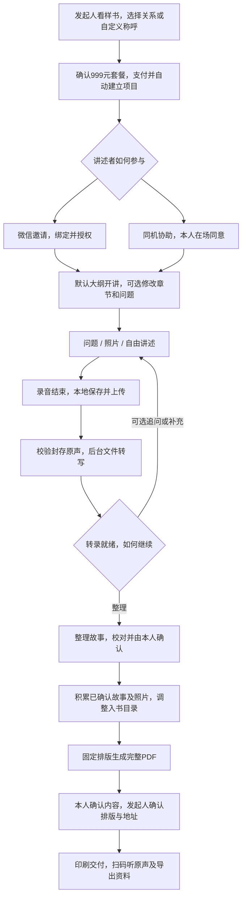

# 时光里岁月成书微信小程序 MVP PRD

> 2026-10-22 当前范围：正文已统一为后端单套固定大纲与可编辑个人计划（[ADR 0008](adr/0008-single-builtin-template.md)）。首版采用固定政策、探针复用和受控人工运营，详见 [ADR 0010](adr/0010-mvp-fixed-policy-and-reuse.md)；MVP 功能与验收目标保留。

| 项目       | 内容                                                                   |
| ---------- | ---------------------------------------------------------------------- |
| 文档版本   | V1.0，产品定稿                                                         |
| 更新日期   | 2026年10月20日                                                         |
| 品牌与产品 | 品牌「时光里」，产品「岁月成书」；项目工作名 TimeNook                  |
| 产品形态   | 微信小程序                                                             |
| 购买者     | 为一位亲友发起人生书项目的人，赠礼关系可选或自定义                     |
| 讲述者     | 一位人生书主人公，可独立使用或由发起人在场协助                         |
| 套餐       | **999元一次性购买，包含一个人生项目和一本实体书**                      |
| 讲述方式   | 分轮录音，可靠保存后转写；按问题、照片或自由回忆讲述，再选择追问或整理 |
| 交付成果   | 实体人生书、书稿PDF、可回听原声的二维码及完整数字资料导出服务          |
| 文档状态   | 目标需求与验收依据；生产规格、服务期限等上线参数见第15节               |

**岁月成书帮助发起人为一位重要的人制作人生书：讲述者按自己的经历回答问题、看照片或自由讲述，录音可靠保存后转成文字，再整理为经本人确认的故事。用户可以调整大纲和问题，最终将文字、照片与真实原声汇成一本书。**

产品链路为“录音 → 可靠保存 → 文件转写 → 可选追问 → 故事确认”。技术实现见[技术架构](architecture/技术架构.md)，内容规则见[大纲与追问设计](architecture/大纲与追问设计.md)。当前实现状态见[前端说明](frontend/README.md)。

## 1 产品定位与目标

### 1.1 用户问题

发起人希望了解父母、祖辈、伴侣、朋友或其他重要人物的经历，也希望送一份有个人意义的礼物，但缺少持续记录、整理和制作的方法。讲述者有故事，却未必习惯打字、写长文或设计一本书。

产品让讲述者负责讲述与确认，发起人负责购买、协助和交付安排，双方可以调整采访大纲与问题，系统负责保存、转写和故事整理。普通经历也可以成书，不要求按时间线答完固定题库。

### 1.2 首批用户与场景

初始招募可优先覆盖约35–55岁的购买子女与约60–80岁的父母，用于检验低门槛语音记录和实体交付；该画像不是注册门槛或固定关系类型。同时覆盖成年亲友的不同关系与实际经历，招募时记录个人计划及使用方式。

| 场景                       | 用户期望                       | 产品回应                             |
| -------------------------- | ------------------------------ | ------------------------------------ |
| 父母生日、退休等节点       | 以父母为主人公的人生礼物       | 购买后邀请或同机协助，最终交付实体书 |
| 伴侣、朋友或老师的纪念时刻 | 记录这个人的经历或一段重要时光 | 动态关系称呼、主题大纲及自定义问题   |
| 日常陪伴或异地联系         | 有具体话题可聊                 | 一次一个问题、短录音、继续未完成故事 |
| 整理老照片                 | 知道照片里的人和经历           | 看照片讲述，照片与对应故事一起入书   |

赠礼包含开启记录与收到实体书两个阶段，购买页说明参与、整理和生产需要时间。首版采用一位成年讲述者本人参与、一位发起人的授权流程；本人自购、未成年人、逝者纪念与多主人公合著开放前另行确定，不能只增加一个关系名称就默认支持。

### 1.3 MVP目标

1. 验证目标发起人是否愿意支付999元购买套餐。
2. 验证讲述者能否低门槛开始，并持续完成多篇已确认故事。
3. 验证故事、照片与原声能否形成可生产书稿，按承诺交付且成本可控。

**北极星指标：完成实体交付且讲述者与发起人确认满意的付费项目数。**

## 2 功能范围

一个项目对应一位主人公、一位发起人及一本实体书。两个人分别制作时购买两个项目，内容与权益独立。

| 编号 | 功能                 | MVP要求                                                                              |
| ---- | -------------------- | ------------------------------------------------------------------------------------ |
| R01  | 产品与套餐           | 样书、原声示例、999元套餐、制作流程、服务期限与售后说明                              |
| R02  | 微信身份与支付       | 支付、结果查询、付款后恢复权益、客服退款申请                                         |
| R03  | 项目与讲述者参与     | 动态赠礼关系/自定义称呼、书名、邀请绑定一位讲述者、同机协助                          |
| R04  | 大纲、问题及分轮录音 | 内置大纲、双角色修改章节与问题、跳过/不适用/禁问、照片/自由讲述、可靠保存后可选追问  |
| R05  | 录音转写与故事       | 可靠封存后文件转写，再整理第一人称故事；原声/转录/稿件分存，支持离开、恢复和失败重试 |
| R06  | 校对和本人确认       | 原声回听、补录、发起人基础文字校对、本人确认对应版本                                 |
| R07  | 照片                 | 录音前或成文后上传照片及可选说明，关联对应故事                                       |
| R08  | 项目主页             | 已确认与待确认故事、制作阶段、继续讲述入口                                           |
| R09  | 书稿                 | 按个人大纲调整入书章节/顺序/故事归属；1套封面及内页模板、书名、完整PDF及必要人工校对 |
| R10  | 原声及资料交付       | 每篇故事原声二维码、PDF下载、客服受理完整资料导出                                    |
| R11  | 实体交付             | 版本确认、收货地址、生产状态、物流单号与质量售后                                     |
| R12  | 隐私与数据权利       | 两角色权限、授权、撤回、更正、删除、期限告知与AI整理标识                             |
| R13  | 运营管理             | 订单权益、任务异常、生产文件、数据请求及处理记录                                     |

### 2.1 范围边界

MVP不包含：

- 家庭提问、多人协作、评论点赞、家庭读者邀请及共同家庭史。
- 实时ASR、录音中字幕、实时语音通话、视频、系统朗读、自动语音纠错及跨故事记忆图谱。
- 多文风、多套封面、故事正文自动合并、自由排版、独立电子书阅读器。章节与问题的增删改、排序属于MVP范围。
- 加印购买、超页加价、会员续订、优惠券、订阅消息和自动提醒。
- 自动供应商与物流接口、经营看板、专业代写、数字人及声音克隆。

原始资料打包、特殊校对、生产对接和售后由运营按明确时限完成；可用受控工具辅助执行，负责人、进度及结果可追溯。用户仍可获得完整资料和实际交付，不以这些工作是否自动化作为权益边界。

## 3 角色与权限

### 3.1 发起人与讲述者

**发起人**是购买并组织项目的人，负责协助、必要校对和交付安排，不限定为讲述者的子女。

**讲述者**是人生书的主人公，负责讲述本人经历、确认内容及决定哪些故事可以入书。

**平台运营**负责处理异常、必要校对、生产、售后和资料请求。

每个项目仅绑定上述两个用户角色。发起人付款不替代讲述者的采集与共享授权。

| 操作                         | 发起人                   | 讲述者                           | 平台运营                   |
| ---------------------------- | ------------------------ | -------------------------------- | -------------------------- |
| 购买、查询支付及退款         | 可以                     | 不要求操作                       | 处理订单                   |
| 录制讲述者讲述               | 讲述者在场同意时协助操作 | 可以                             | 不代替讲述者讲述           |
| 上传照片、阅读稿件及回听原声 | 经讲述者授权可以         | 可以                             | 经明确授权处理必要事项     |
| 基础文字校对及书名设置       | 可以，改稿后重新确认     | 可提出更正或补录                 | 经授权处理必要修正         |
| 编辑大纲、章节和问题         | 经授权可以               | 可以，决定是否回答               | 审校默认文案或按授权工单协助 |
| 跳过、不适用和禁问           | 协助表达本人选择         | 可以，重新启用禁问需本人明确选择 | 不代替本人决定             |
| 确认事实与允许入书           | 不代替讲述者决定         | 可以                             | 不可以                     |
| 确认排版、地址及印刷         | 内容经讲述者确认后可以   | 可拒绝未授权内容入书             | 检查并生产确定版本         |
| 下载或申请导出               | 经讲述者授权可以         | 可以                             | 核验并交付                 |
| 更正、撤回及删除申请         | 处理自身资料             | 可以                             | 核验并执行                 |

首版采集讲述者本人讲述。发起人可以协助操作和校对，发起人代述不标记为讲述者原声，也不进入独立补充叙事流程。

### 3.2 同机协助

讲述者在场并明确同意后，发起人可用自己的设备录制、展示整理稿并协助确认。记录实际讲述者、操作人、同意与确认方式。

没有个人微信的讲述者仍可通过客服撤回授权或处理本人资料。讲述者独立进入项目时完成一次微信绑定，之后无需创建或记忆本产品密码。

## 4 用户流程

上传和转写可在后台继续，用户不必留在采访页。等待期间可以回听本地已保存录音、继续补录或选择完成；补录的片段分别保存、转写，整理时不能遗漏。

### 4.1 购买与邀请

发起人在首页选择赠礼关系或填写自定义称呼，进入同一个999元套餐。系统提供的类型由运营维护，增加类型不要求重新发布一套页面；自定义称呼只作用于当前项目。关系仅影响称呼和邀请文案，不决定性别、婚育、职业、价格或权限。

支付经服务端核验后自动建立项目、一位主人公及默认中性大纲，返回邀请入口。姓名和书名可稍后填写，默认通用书名为“我的时光手记”；修改关系称呼不替换主人公、不重建权益。代码模板升级或关系类型停用不影响已售订单恢复。

邀请展示发起人、为什么记录，以及“说一段 → 保存后看看故事 → 确认成书”的过程。讲述者看清资料用途、共享范围、入书决定及撤回方式，可参与或暂不参加。邀请转发不授予访问；绑定申请经发起人核验，绑定前不显示私密内容，重新绑定走客服核验。

### 4.2 开始讲述

项目主页直接给出一个可回答的问题，也可看照片或自由讲述，不需先完成大纲设置。双方可从次要入口修改个人章节和问题；讲述者可换题、稍后回答、跳过、不适用或设定禁问。未答完题库不阻止成书。

有未完成采访时优先继续原故事，有待确认稿时可以确认或补充。用户掌握记录节奏，不要求每天登录。

### 4.3 成书与收书

约20篇已确认故事作为推进建议，不是强制篇数。可以在少量已确认故事时预览书稿，实际生产须满足公示页数和规格。

讲述者确认入书内容，发起人校对完整PDF并确定地址，运营检查后生产。收到书后可阅读、扫码回听并备份数字资料。

## 5 页面与交互

### 5.1 信息架构

**项目主页**是已购买且已建立项目用户的默认入口，集中展示继续讲述、故事状态和制作阶段。讲述者接受邀请后进入对应项目。未购买用户进入产品首页，已购买用户再次打开小程序不重复经过营销及支付流程。录音、故事详情、书稿和订单从项目主页进入。

“我的”提供订单、项目列表、资料申请、隐私与客服。一个项目时直接进入，多个已购买项目时显示简单切换列表。

### 5.2 页面要求

| 页面             | 对象               | 内容与动作                                                                                 |
| ---------------- | ------------------ | ------------------------------------------------------------------------------------------ |
| 产品及购买页     | 发起人             | 样书、999元含一本实体书、本人需参与；动态关系或自定义称呼，确认套餐后支付                  |
| 项目设置及邀请页 | 发起人、讲述者     | 支付后自动建立项目；称呼和书名默认，资料可选修改；固定邀请、三步说明、接受及授权、陪同开始 |
| 项目主页         | 发起人、讲述者     | 故事列表、已确认及待确认数、阶段；继续讲、看照片讲、预览                                   |
| 大纲与问题页     | 讲述者、授权发起人 | 章节/问题增删改排序、回答状态、禁问；显示并发编辑冲突                            |
| 采访页           | 讲述者、协助发起人 | 一题/照片/自由讲述、计时及停止、本地/云端保存、等待文字、补录、就绪后的可选追问或整理      |
| 故事详情页       | 讲述者、发起人     | 整理稿、对应原声、照片；确认、补录、文字校对、是否入书                                     |
| 书稿及印刷确认页 | 讲述者、发起人     | 固定书封、目录、内页节选、真实页数及完整PDF；版本、实际规格、地址、首本权益和印刷确认      |
| 订单页           | 发起人             | 支付结果、生产阶段、物流单号、客服及售后                                                   |
| 原声播放页       | 发起人、讲述者     | 故事标题、对应录音列表及播放，无权限时显示拒绝访问                                         |
| 我的及服务页     | 发起人、讲述者     | 项目切换、PDF下载、原资料申请、隐私与客服                                                  |

页面区块可合并。收货地址在印刷确认时采集。采访的准备、录音中、已保存与追问、整理中是同一采访页面的状态，不要求开发为独立路由；原型为说明状态而拆分画板。

产品首页按真实手机首屏排布，390×844参考视口内可见产品价值、999元含一本实体书及赠礼关系选择入口。操作正文保持清晰对比，亲情照片或书籍效果图限于营销展示，不能覆盖交互文字。原型使用的生成书籍图标注“效果示意”；正式售卖采用有权使用的素材及真实打样，不能将效果图作为客户案例、真实经历或印刷品质证明。

### 5.3 低门槛与适老交互要求

- 首屏一个主要行动：“开始说”或“继续讲述”。
- 每屏围绕一个任务呈现，标题、说明和状态不重复解释同一件事。普通操作页只保留一个问题或状态、一句必要提示和主要按钮；不以缩小字号容纳长说明。
- 常规引导文字以约40字以内为设计目标，不含导航、按钮、用户故事正文及必要授权告知。邀请页直接说明邀请人、资料用途、共享对象及选择权，完整说明从次要入口查看。
- 录音点击开始、点击结束，下一段录音用于继续讲述。
- 一次一个短问题，大字显示，可换题或跳过。
- 采访准备页只显示当前问题、点按提示和录音按钮；首次麦克风说明在申请权限时出现，不常驻页面。录音中突出计时和停止；本地成功提示“已保存在本机”，云端校验后提示“云端已保存”。文字等待只说“正在整理文字”，失败说明已保存的内容和下一步，不展示后台任务术语。
- 主按钮至少48×48逻辑像素，正文建议20逻辑像素起，以目标讲述者真机试用校准。
- 草稿正文完整呈现，不为减少界面文字而截断故事。标注“AI整理 · 请您核对”，主要按钮明确“没问题，同意入书”；补充、请发起人改字及暂不入书作为次要动作。
- 等待整理时可以离开，返回后查看结果和下一步。
- 失败提示只说明当前结果、已保存的内容和下一步；未保存时保留“请先别退出”的直接提示。确认成功页不重复列出讲述者、版本、原声等后台信息。
- 讲述者页面不要求操作付款、额度或生产费用。

## 6 分轮录音与故事生成

### 6.1 R04 大纲、问题和录音

首版后端内置一套经过审校的中性大纲，包含可选章节、问题目的和短问题。复制到项目后，个人计划独立保存，可编辑或清空；默认内容随代码更新不覆盖旧项目。具体题量与文案在 D09 冻结，不设必答比例。

发起人与讲述者均可新增、改名、排序、停用章节，新增/改写/重排问题；讲述者可稍后回答、跳过、不适用、禁问或自由发挥。关系称呼不预设婚恋、育儿或职业经历。个人编辑保留已回答关联和禁问选择；重新开启禁问需本人明确选择。

一轮为：问题/照片/自由回忆 → 录音结束 → 本地保存与云端封存 → 文件转写 → 可选追问或整理。建议每段1–5分钟，上限保存行为经真机验证后确定；补录产生新片段，原始素材不静默覆盖。

追问使用当前实际问题、当前故事正式转录及本人偏好，每次一条短问题，允许改写、换一个、跳过或结束。只在转录就绪后请求，不承诺停录后立即出现。等待时可按原问题继续补充或提交整理；用户换题/结束后不再弹出旧追问。建议每故事最多主动推荐3次，用户主动补录不受该推荐次数限制，额度以D04为准。

### 6.2 R05 保存、转写与等待

- 先保存真实本地文件，再上传；本地保存失败提示暂勿退出，保留可重试内容。
- 区分待上传、上传/校验、云端已保存、文字处理中、故事整理中及失败；云端封存成功后才声明云端保存完成。
- 每片段封存后自动后台转写；转写完成不等于故事已确认。原声可回听，识别错误可后续校对。
- 上传、转写或整理期间可以离开，回来恢复原采访与任务；等待文字时仍可补录或选择完成。
- 整理故事须等待本次选定的全部已保存片段完成转写，不能漏后半段。新增素材与迟到任务不覆盖新稿。
- 弱网按文件重试，重复完成/任务请求不新增素材或重复扣用户额度；转写/整理失败从已保存原声重试，不要求全部重讲。
- 未保存且无法恢复的部分明确说明，不虚报成功。系统中断后只恢复实际仍存在的文件。

### 6.3 故事输出

输出包含原始转录、第一人称自然叙事稿、标题和基础主题。以讲述者本人语气为主，删除无意义口头重复、理顺语序，保持可读性。

录音、转录和整理稿分别保存。编辑文字不改动原声，原声也不要求逐句等同于整理稿。每篇故事可回听所有关联讲述片段。

AI不得编造人物、年份、地点、对白、情节或本人观点。

| 输入情况             | 输出要求                             |
| -------------------- | ------------------------------------ |
| “八几年去了上海”     | 保留模糊时间或追问，不自动指定年份   |
| “家里条件不好”       | 可追问具体经历，不补造借债或饥饿情节 |
| 同一故事出现两个年份 | 提示核对，不自行判断哪个是真的       |
| 不知道照片人物或年代 | 说明留空，不根据照片猜写事实         |

跨故事事实一致性由发起人和运营校对。必要的待核对问题处理完后，故事重新由讲述者确认。

### 6.4 计划、实际提问与入书版本

实际向本人展示的问题保存当时问法，修改未来问题不改变历史录音关联。删除计划章节不删除已回答故事，用户可重新归类。双方并发编辑提示冲突，不静默覆盖。

只改未来问题不撤销已有故事内容确认；修改实际入书章节标题、顺序或故事归属，生成新书稿并重新确认；正文、照片或原声清单变化生成新故事版本。空章节不印，未回答问题不补写虚构内容。

## 7 故事确认与照片

### 7.1 R06 本人确认

生成稿默认为待本人确认。讲述者可阅读或听发起人读给本人听，确认记录关联具体版本、确认人和操作人。

发起人可在基础编辑框中改正文字，讲述者可补录经历后重新整理。修改后的故事重新进入待确认，旧确认不适用于新稿。

文字校对可能与录音原话不同，故事页说明文本经过校对；原始讲述仍可回听。更正后的事实与其确认记录对应，不伪造或修改本人声音。

讲述者可决定某篇是否入书。只有已确认且获准入书的故事参与书稿生成。

### 7.2 R07 照片起讲与补图

照片可在两个时点加入：

1. **讲述前**：发起人或讲述者选一张照片，以“这张照片在哪里拍的，当时发生了什么”作为引导，录音与照片组成同一故事。
2. **讲述后**：在故事详情补充照片和可选说明，不需要重新录制已有内容。

照片不是讲述或入书的必填条件。没有照片也能完成故事，照片也不替代讲述者的事实说明。

固定模板优先保留完整照片画面。印刷清晰度由预览与运营检查；需要特殊裁切时先处理，再由用户确认。照片人物、时间和地点未知时允许不填写。

## 8 书稿与原声交付

### 8.1 R08 项目进度

主页展示已确认故事数、待确认数和记录中、校对中、生产中等实际阶段。“继续讲述”返回未完成采访；成书准备情况以确认内容及可用页数为依据。

### 8.2 R09 个人目录与固定排版

系统从项目大纲与已确认故事形成实际入书目录，用户可调整章节标题、顺序和故事归属，空章节不印。采访计划与书稿目录分别保存，不把未答题目当欠缺内容。排版仍使用1套封面和1套内页模板，支持书名、称呼及可选封面照片；可改目录不等于自由排版。

结构为封面、扉页、目录、故事标题与全文、照片及说明、原声二维码及制作说明。完整故事参与排版，不以摘要替代已确认正文；文章跨页时保持连续。

成书总览展示唯一模板的封面、书名、已确认故事数、当前版本、实际页数、简短目录和内页节选，突出“查看完整书稿”。目录与节选从当前版本生成，不用固定故事数量或百分比表示完成度。演示书稿的3篇故事、12页仅用于原型，不作为套餐页数或成书门槛。

完整预览包含全部入书内容、照片、二维码位置及最终页数。概览和节选不替代完整PDF校对。页面使用“每篇故事可回听对应原声”，不将整理后的文字描述为逐字转录。运营的必要修正需生成新预览，由用户重新确认。内容不足继续记录，超出固定规格由发起人选择不入书的故事后重新预览。

### 8.3 书稿版本与印刷确认

讲述者确认内容，发起人校对PDF中的姓名、正文、照片、目录、页数及排版，再确认收货地址。确认对应同一确定版本。

印刷确认页集中展示书名、当前版本、实际页数、已公示的制作规格、制作数量1本、收货地址及预计生产时间，明确“已付999元，首本权益已含，本次无需支付”。讲述者未确认内容或发起人未完成逐页校对时，提交动作不可用。

入书内容或封面发生变化时生成新版，旧的待生产确认失效。运营核对未确认故事、事实问题、图片、原声关联和生产规格，符合条件后生产该版本。

交付后提供阅读、回听及资料服务。资料更正和删除由客服受理，已印刷实物的内容不会因在线改稿而自动改变。

### 8.4 R10 原声二维码

每篇获准入书且有原声的故事设置一个二维码，放在该故事起始位置，绑定所印版本对应的讲述片段。故事跨多页时无需每页重复设置。

扫码进入微信小程序原声页，播放本人真实录音，多轮片段按顺序排列。文字编辑不会使二维码播放合成或篡改后的声音。

纸面入口稳定，音频临时访问地址变化不改变二维码。仅绑定讲述者及经讲述者授权的发起人可访问；未授权扫码不展示私密标题、故事或录音。

撤回授权或删除音频后停止对应访问，显示无权限或内容已移除。已交付纸书无法远程回收，处理删除时向本人说明。

### 8.5 数字资料

书稿PDF可预览和下载。完整资料包含原声、原始转录、确认稿、照片、PDF及故事与文件对应清单。

发起人或讲述者可通过客服申请完整资料包，运营核验权限后人工打包，通过仅申请人可访问的入口在公示时限内交付。该服务包含在999元内，不额外收费，也不以续费为前提。

制作权益期限、原声在线访问期限、资料保存和删除期限分别说明。在线访问依赖约定服务期限，已导出文件可以由用户自行保管。

## 9 套餐、订单与售后

### 9.1 R01及R02 套餐规则

首版每项政策选择一个已确认规则并形成套餐快照；历史订单不追溯改期或改权益，未确定数值保持待定。不同服务期限分别说明，人工例外处理遵守已公示政策，不要求通用政策编辑器。

**999元一次性套餐**包含一位讲述者的人生项目、约定额度内录音与整理、固定模板书稿、PDF、原声二维码、完整资料导出服务及一本实体书。

售卖前展示：

- 书籍尺寸、装帧、页数范围和配送地区。
- 制作期限及起算方式、音频在线访问和资料保存期限。
- 录音、照片与整理额度。
- 生产交付预计、退款及质量售后规则。

约定配送范围内的首本书费与运费已含在999元内，提交印刷不重复收取。不支持地区在付款前告知，套餐外没有额外份数或超页购买入口。

支付以服务端核验为准。取消或失败不授予权益；成功后退出可恢复同一订单、权益和项目，重复回调不重复创建。

### 9.2 R11 生产及物流

使用一种公示尺寸、装帧和页数范围。运营检查生产文件，人工交给供应商并登记阶段和物流单号；供应商只获得生产与配送所需资料。

状态为：等待确认 → 待生产审核 → 生产中 → 已发货 → 已交付。用户凭物流单号查询快递，生产异常由客服告知处理方式。

预计生产周期从书稿锁定并经运营审核通过后起算，具体工作日数在供应商打样和履约核定后公示。内容积累时间由讲述者节奏决定，不从初次付款日承诺固定一个月成书。

投产前可申请撤回，由客服核实实际生产状态；投产后不直接变更文件或地址。因质量问题返工重印属于原订单售后。

### 9.3 退款与质量售后

首批通过客服受理，运营按付款前公示的政策执行。

| 情形                           | 处理要求                                 |
| ------------------------------ | ---------------------------------------- |
| 未参与或讲述者不愿开始         | 核实订单和使用记录，受理退款             |
| 已使用但未生产                 | 按已公示的服务和实体部分规则处理         |
| 平台故障导致无法交付           | 恢复、补做或退款，不重复收费             |
| 破损、漏页、错版、平台排版错误 | 核对确认版本与生产记录，补寄、重印或退款 |
| 确认后发现事实错误             | 受理资料更正，解释已生产实物的处理边界   |

退款金额、申请和处理时限必须明确。退款不静默删除讲述者资料，重复操作不重复退钱，退款与权益及生产状态保持一致。

## 10 状态与一致性规则

| 对象       | 状态                                                           |
| ---------- | -------------------------------------------------------------- |
| 交易       | 待付款、已付款、已关闭、退款处理中、已退款                     |
| 素材       | 本机已保存、待上传、校验中、云端已保存、失败、已移除           |
| 转写及故事 | 文字处理中、转写失败、故事整理中、待确认、已确认、失败、已移除 |
| 项目       | 待参与、记录中、校对中、待交付、已交付、已终止                 |
| 书稿及生产 | 待确认、确认失效、已确认、待审核、生产中、已发货、已交付       |

1. 一个套餐只有一份首本制作权益，重复提交只产生一个生产订单。
2. 一个项目只有一位主人公，素材与任务不能串项目。
3. 修改后的故事重新确认，印刷使用双方确认的同一版本。
4. 原声、转录与稿件分别保存，文字修改不改变原声。
5. 阅读、回听、下载与资料申请均校验授权。
6. 撤回或删除影响待生产稿时停止可停止的排产并人工处理。
7. 删除请求覆盖应处理的副本和衍生资料。
8. 单篇处理失败可从保存素材重试，不使整个项目失效。

## 11 隐私、标识与服务准入

采集前向讲述者告知用途、服务商、向发起人共享范围、期限和撤回方式。内容默认私有，不用于公共模型训练；服务商配置和合同支持该约定。

讲述者可申请更正、导出、撤回和删除。涉及敏感个人信息时按适用规则取得单独同意。删除后停止在线访问，活动数据与备份处理时限公示，交易记录与故事资料分别处理。相关方案按[《个人信息保护法》](https://www.cac.gov.cn/2021-08/20/c_1631050028355286.htm)核验。

整理稿注明“根据本人讲述经AI整理”，下载与导出文件带适用标识，真实原声不误标为合成音频。方案按[生成内容标识办法](https://www.cac.gov.cn/2025-03/14/c_1743654684782215.htm)及[生成式AI服务管理暂行办法](https://www.cac.gov.cn/2023-07/13/c_1690898327029107.htm)核验。

基础云服务使用阿里云，包括数据库及私有对象存储；文件ASR首选豆包（火山引擎），文本模型首选DeepSeek，用于可选追问和故事整理。按实际使用的服务、用途、地域、数据保留及第三方副本能力进行隐私告知，并核对训练使用、保存和删除条款。

对外服务前检查微信主体、类目、支付路径、iOS与Android适用情况、隐私与录音授权、印刷供应商及实际业务准入。产品交付为个人人生书制作，不承诺正式出版发行或永久云端访问。

## 12 运营与质量要求

### 12.1 R13 运营能力

运营能够维护关系类型、审校默认大纲/问题文案，查订单权益及失败转写/整理任务、处理必要校对、生产、物流、售后及资料请求。默认文案经审校后随代码版本交付，更新不覆盖个人计划。首版复用共享工单、详情及必要操作表单，人工核验/判断/交接，系统保证权限、资金和版本约束；私人内容处理须有工单及限时授权。

处理记录包含操作人、时间、原因与版本。查看用户私密资料须有明确授权，仅供本次必要处理。

### 12.2 质量目标

| 项目       | 验证口径                                                                                                                                            |
| ---------- | --------------------------------------------------------------------------------------------------------------------------------------------------- |
| 开始录音   | 讲述者已绑定并授权，从项目主页到开始录音目标不超过60秒                                                                                              |
| 素材可靠性 | 弱网、来电、切后台与重试中，已提示云端保存的素材不丢失或串项目                                                                                      |
| 整理时延   | 从用户提交整理且全部输入已云端保存起，含排队/依赖转写；5分钟以内输入95%在3分钟内成功出稿为内部试点目标；失败/人工接管单列，尚未结束的任务显示处理中 |
| 真实性     | 不新增无来源事实，入书内容均有本人确认，改稿后重新确认                                                                                              |
| 纸书与原声 | 实物与确认稿一致，纸面二维码可扫且播放正确片段                                                                                                      |
| 导出与权限 | 资料在平台外可读，未授权者无法读取或下载                                                                                                            |

该时延目标须经阿里云实际短片段验证，不作为供应商SLA；等待超出页面预算时允许离开，不能伪写失败或重复提交。字号、耗时和口音效果通过目标讲述者真机验证；方言宣传以实际覆盖和识别效果为依据。

## 13 验收场景

| 编号 | 场景           | 通过条件                                                                                                          | 要求          |
| ---- | -------------- | ----------------------------------------------------------------------------------------------------------------- | ------------- |
| A01  | 了解及购买     | 首屏可见999元含一个项目及一本实体书；选择关系或自定义称呼后，对象、书名与邀请文案一致，进入同一套餐及配送期限规则 | R01、R02      |
| A02  | 付款成功后退出 | 自动创建默认项目，不必填姓名或书名即可邀请；退出重进恢复同一权益及项目，不重复扣款或创建                          | R02           |
| A03  | 付款取消或失败 | 不获得权益，可查询和重新支付                                                                                      | R02           |
| A04  | 邀请转发       | 外人不能取得讲述者身份和私密内容，绑定后旧邀请失效                                                                | R03、R12      |
| A05  | 讲述者参与     | 同页看清邀请人、三步过程、用途、共享范围与选择权；完成授权后开始录音                                              | R03、R04、R12 |
| A06  | 同机协助       | 记录讲述者同意及操作人，无个人微信也可申请撤回和删除                                                              | R03、R12      |
| A07  | 问题与追问     | 首屏一个短问题、必要提示和清晰录音按钮；不重复展示操作说明，可换题、回答当前追问或直接整理                        | R04           |
| A08  | 看照片讲述     | 可先选照片再录音，照片与生成故事对应；无照片也能完成                                                              | R04、R07      |
| A09  | 弱网及中断     | 不虚报保存，已保存片段可恢复，重试不重复生成                                                                      | R04、R05      |
| A10  | 整理失败       | 原声可回听，从已保存内容重试，不要求全部重录                                                                      | R05           |
| A11  | 内容真实性     | 模糊与矛盾事实提示核对，不编造确定事实                                                                            | R05、R06      |
| A12  | 校对与补录     | 文稿变化后重新确认，原始音频不被文字编辑改动                                                                      | R05、R06      |
| A13  | 事后补照片     | 照片及说明加入已有故事，无需重新录制已保存讲述                                                                    | R07           |
| A14  | 项目状态       | 已确认、待确认及制作阶段与真实记录一致                                                                            | R08           |
| A15  | 完整书稿预览   | 总览含固定书封、目录、内页节选和真实页数；完整PDF含全文、照片及二维码位置，可逐页校对                             | R09           |
| A16  | 确认后改稿     | 旧确认失效，新版本确认后才可生产                                                                                  | R06、R09、R11 |
| A17  | 未确认内容印刷 | 阻止提交，待确认或事实问题处理完后再确认                                                                          | R09、R11      |
| A18  | 首本权益       | 印刷页显示已付999元、制作1本和无需再支付；不二次收取书费及约定运费，重复提交不重复生产                            | R02、R11      |
| A19  | 实物交付       | 与确认PDF一致，文字照片完整，二维码播放对应真实录音                                                               | R09、R10、R11 |
| A20  | 未授权扫码     | 不泄露私密内容，讲述者及经授权发起人可回听                                                                        | R10、R12      |
| A21  | 资料导出       | 公示时限内交付完整可读资料，免额外费，下载受权限保护                                                              | R10、R12、R13 |
| A22  | 撤回和删除     | 访问停止，影响待生产稿时暂停并处理                                                                                | R10、R12      |
| A23  | 重复退款       | 不重复退钱，权益与生产状态一致                                                                                    | R02、R11      |
| A24  | 质量售后       | 可核对确定版本、生产及物流，按公示规则处理                                                                        | R11、R13      |

产品入口和开发清单符合第2节范围，家庭提问、多人协作、加印和自动提醒不作为验收依赖。

### 13.1 关系、媒体与个人计划验收

| 编号 | 场景           | 通过条件                                                                                         | 要求          |
| ---- | -------------- | ------------------------------------------------------------------------------------------------ | ------------- |
| X01  | 动态赠礼关系   | 新增类型无需改业务代码；自定义称呼有效；类型停用不改旧订单/权限；更名不换主人公                  | R03           |
| X02  | 保存后文件转写 | 录音中无字幕；本地与云端保存区分；仅封存文件进入转写，完成后才给可选追问                         | R04、R05      |
| X03  | 等待与恢复     | 等待可离开/补录/提交整理；重复任务不重复扣用户额度，失败保留原声；迟到结果不覆盖当前稿或问题     | R04、R05      |
| X04  | 图片与支付     | 原图/预览/印刷图私有且不覆盖，格式/方位/低清处理；实际商品准入、双端支付、查单/退款/发货管理验收 | R02、R07、R11 |
| X05  | 个人大纲与问题 | 双方编辑、增删改排序、空白/默认开讲、并发冲突、模板更新不覆盖、不强制答完                        | R04、R09      |
| X06  | 追问与版本     | 中性单题，改写/跳过/禁问/结束；改未来问题不改历史或重转写，目录变更重新确认                      | R04、R06、R09 |

## 14 试点指标与上线要求

验收映射与实施细节见[交付与运维](architecture/交付与运维.md)。

### 14.1 经营验证

漏斗：目标发起人访问 → 999元支付 → 讲述者参与 → 首篇确认 → 第5篇确认 → 书稿确认 → 实体交付。

记录渠道、订单及退款、参与时间、首段保存、确认数量、生产与交付、售后和必要人工时长。分析记录不包含私人故事正文、照片或录音。

| 指标          | 口径                                                      | 初始目标                           |
| ------------- | --------------------------------------------------------- | ---------------------------------- |
| 999元付费验证 | 同一渠道100名真实目标购买者，排除测试、赠送及全额退款     | 至少10–15人真实付款                |
| 讲述者激活    | 支付满7日项目中已有首段成功保存的比例                     | 至少70%                            |
| 持续讲述      | 首篇确认满14日项目中完成至少5篇确认故事的比例             | 至少50%                            |
| 成稿          | 支付满45日项目中形成双方确认生产稿的比例                  | 至少40%                            |
| 交付与满意度  | 承诺到期项目逐单核对，交付后7日访谈讲述者与发起人         | 记录是否按时、是否像本人及推荐理由 |
| 单项目贡献    | 999元实收减支付、AI、存储、必要人工、印刷、物流和售后成本 | 覆盖可变成本                       |

以上为项目试点判断目标，不是行业基准。分批累计招募30–50个真实项目，父母赠礼项目可按家庭招募，观察至少一个完整成书与交付周期。

### 14.2 上线要求

完成核心页面及权限评审、目标讲述者真机验证、一份内部完整项目的真实打样、原声播放和资料导出验证。第13节A01–A24及X01–X06全部通过后开展付费试点。

原声丢失、跨项目访问、错版印刷、重复收费及删除后仍可访问属于上线阻断问题。排期以团队、打样与实际审核结果为依据。

## 15 上线前待确定的产品参数

| 编号 | 参数           | 必须明确的内容                                                                  |
| ---- | -------------- | ------------------------------------------------------------------------------- |
| D01  | 实体书规格     | 尺寸、装帧、纸张、彩印范围、最小及最大页数，适配999元套餐                       |
| D02  | 制作权益       | 制作期限、从付款或讲述者参与何时起算、未开始及暂停的处理                        |
| D03  | 资料服务       | 原声在线访问、资料保存、导出申请与删除处理期限，以及到期说明                    |
| D04  | 内容额度       | 录音、照片和整理额度，足够完成规定规格的一本书                                  |
| D05  | 配送           | 999元含运费的地区、不支持地区的付款前提示                                       |
| D06  | 交付与人工时限 | 必要校对、完整资料包、生产、物流、客服及售后的处理时限                          |
| D07  | 退款           | 未开始、已使用、已投产及质量问题的规则、金额和时限                              |
| D08  | 授权与准入     | 讲述者绑定、同机同意、微信类目/商品支付及发货管理、隐私、AI及生产的实际适用方案 |
| D09  | 内容方案       | 内置大纲、原创/授权题目、内容负责人、禁问规则及用户试用质量阈值                 |
| D10  | 关系场景       | 首批关系类型及自定义称呼；本人自购、未成年人、逝者纪念等开放前的角色与授权方案  |

## 16 参考资料

- [原始需求《岁月成书.pdf》](/Users/bryce/projects/timenook/docs/岁月成书.pdf)：语音讲述、故事确认、照片、成书及原声交付。
- [Remento 产品流程](https://www.remento.co/how-it-works)：赠礼、题目引导、录音成文、故事和照片形成实体成果。
- [Remento 赠礼指南](https://help.remento.co/en/articles/8634394-guide-to-gifting-remento)：发起人与讲述者分工及参与入口。
- [Remento 常见问题](https://www.remento.co/faq)：照片可作为讲述起点或事后补充、稿件编辑、原始资料下载。
- [Remento 印刷指南](https://resources.remento.co/printing-a-book/ordering-your-book)：完整PDF预览、印刷确认及故事与原声关联。
- [Remento 功能参考表](/Users/bryce/projects/timenook/docs/Remento_产品功能参考.md)：公开产品能力与本MVP边界。
- [小鹿光年](https://deerlight.cn/)及[公开录音演示图](https://static.deerlight.cn/landing/images/home-feature-1.png)：微信小程序、大录音按钮与简洁问题呈现。

Remento资料按2026年10月17日的官网与官方帮助说明引用，用于产品功能参考。岁月成书的价格、期限、生产规格、权限与售后以本PRD及售卖前公示参数为准。
